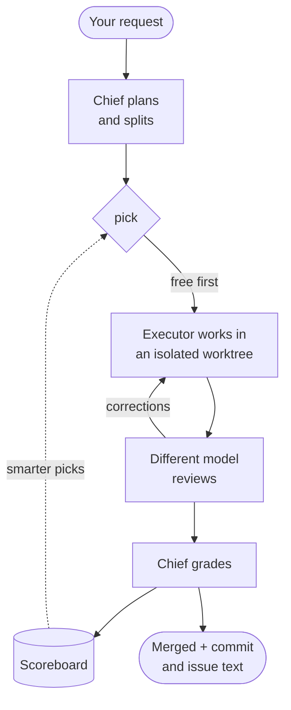

<div align="center">


# agent-crew-chief

**Your coding agent stops working alone and starts running a crew.**

It splits the job, hands each piece to the best *free* model you have, gets a second opinion from a different model, grades every delivery, and learns who to trust in each project.

[](https://github.com/pauloroos/agent-crew-chief/actions/workflows/ci.yml)
[](https://github.com/pauloroos/agent-crew-chief/releases/latest)
[](#install)
[](#install)
[](LICENSE)

**English** · [Português](README.pt-BR.md)

</div>

---

## Why you'd want this

You probably have more AI firepower than you use. There are free models in OpenCode, a quota in Antigravity, a Codex subscription, maybe a third-party key or two. Yet one agent does everything and burns the expensive quota on boilerplate.

**agent-crew-chief** turns the agent you already work in (Claude Code, Codex, OpenCode, Cursor, Antigravity…) into a **crew chief**:

| Feature | What you get |
|---|---|
| 🆓 **Free first** | Free models get the work. Paid ones step in only when the free ones can't deliver, or the task is too complex to split. |
| 🔍 **Real review** | Every delivery is read by a **different model family** before you see it. The chief has the final word. |
| 🏆 **A scoreboard that learns** | Each delivery is graded on how many corrections it needed and how closely it matched the request. Picks improve with every job, per project and per kind of work. |
| 🎲 **No model left behind** | Low scorers and newcomers still get a second chance on low-risk work. Models improve, and the scoreboard notices. |
| 🧱 **Safe by construction** | Isolated git worktrees, a secret filter on every brief, writes outside the worktree auto-rejected, mass-deletion alerts, hard timeouts. |
| 📒 **Everything on record** | Each job leaves a record in your repo, with a commit message and an issue comment ready to paste. |

No server, no daemon, no dependencies: one skill plus a stdlib Python CLI that any agent can drive.

## How it works



1. `job new`: your request is recorded verbatim.
2. `piece add`: it is split into pieces, each with a work type and a risk level.
3. `pick`: an executor is chosen. Hands-on work (`code`, `tests`, `refactor`, `docs`, `data`) only goes to free models, OpenCode first; thinking work (`review`, `design`, `diagnosis`, `research`) goes to any free model and escalates to a paid one only when needed. Within that, decayed score decides, with an occasional second chance. Ties are spread over the job, and a model that just hit its quota sits out for a while.
4. `dispatch`: the brief runs in a fresh worktree with a hard timeout. Every attempt is recorded, whatever its status, with its duration, agent steps and tokens. An attempt that exits cleanly without changing anything is `no_change`, a failure, not `ok`. Independent pieces can be dispatched in parallel.
5. `pick --review` + `dispatch --review`: a model outside the executor's quota family reviews the work.
6. `correction` + `grade`: the script computes the score, and the scoreboard is rewritten. After a correction the next `dispatch` starts from the last `ok` attempt's branch, so the brief only describes the adjustment and the diff shows only that (`--fresh` starts over from `HEAD`, `--base <n|branch>` picks the starting attempt). Every executor that worked on the piece keeps its own grade.
7. `accept` / `discard` + `close`: the work lands or is dropped, and you get the commit message and the issue comment, which list every executor with its score.

## Spec-driven work (optional)

For a feature with several requirements, the request can live in a spec folder
instead of a paragraph. crew-chief reads the [spec-kit](https://github.com/github/spec-kit)
layout (`specs/NNN-slug/` with `spec.md`, `plan.md` and `tasks.md`) and turns
its tasks into pieces. Tested with spec-kit 1.2.x. It does not need spec-kit
installed, never creates `.specify/`, and never edits `spec.md` or `plan.md`.
The grammar is reimplemented; no spec-kit template is copied.

The coordinator sizes the process to the request: a **trivial** edit gets no job
and no spec, a **small** request gets only a job, and a **project** gets the
cycle below.

```bash
crew-chief spec new --title "CSV export"                    # or use an existing spec-kit folder
crew-chief spec import --job <id> --spec-dir specs/001-csv-export
crew-chief spec status --job <id>                           # progress, ready and blocked tasks
crew-chief brief render --job <id> --piece 3 --out brief.md # then pick + dispatch
crew-chief brief render --job <id> --piece 3 --review --out review.md
crew-chief brief render --job <id> --converge --out converge.md
crew-chief ruling add --job <id> --text "<decision> — <why> — <cost if wrong>"
crew-chief decision add --job <id> --from-ruling 1
crew-chief usage add --job <id> --role coordinator --tokens-in 52000 --tokens-out 9000
crew-chief economy --job <id>
```

(`crew-chief` stands for `python -I .agents/skills/crew-chief/scripts/crew-chief.py`.)

- **Import.** `spec import` turns each open task of `tasks.md` into a piece
  (`ref` = the task id; `[X]` tasks are skipped) and keeps a sidecar,
  `crew.toml`, next to it. spec-kit has no place for the facts an executor
  needs, so the sidecar holds them, one `[tasks.T012]` table per task: `type`,
  `risk`, `accept` (references such as `FR-001` or `US1/AC1` into `spec.md`),
  `files` it may change, a `proof` command, an optional `expect` text, `depends`
  and `interfaces`; a top-level `global_constraints` list applies to every task.
  `import` warns about tasks without a proof, sidecar entries and pieces whose
  task id is gone, `[P]` tasks of one phase that share files, and **stale
  pieces**: when `tasks.md` is regenerated and a task's text changed, its piece
  is refused by `dispatch` and `brief render` until you fix the spec and import
  again, so a piece never points at the wrong task.
- **Briefs.** `brief render` writes the minimum an executor needs: the task, the
  acceptance criteria it points at (their text, not the whole spec), the
  constraints, interfaces, allowed files and proof. With `--review` it writes
  the reviewer's brief, which asks for two verdicts: spec (`done`, `missing`,
  `misunderstood`, `extra`) and quality (`Critical`, `Important`, `Minor`).
  `--converge` writes the last pass, which compares the code with the whole
  spec and lists the gaps that are not tasks yet, or answers `Converged`.
- **Proof.** After an `ok` attempt, `dispatch` runs the task's `proof` in the
  worktree. A failing or timed-out proof makes the attempt `proof_failed`, with
  the output in the note, and counts as a failure. Hands-on pieces without a
  proof are refused (`--no-proof` skips it and records that). A piece whose
  dependency or earlier phase is not accepted yet is refused (`--ignore-deps`
  overrides and records that). Files changed outside the task's `files` show up
  as a `scope:` line. Pieces without a spec task work as before and need no
  proof.
- **Accept.** `accept` marks the task `[X]` in `tasks.md` and commits that one
  line (`docs(tasks): mark T012 done`); CRLF, BOM and the rest of the file are
  left alone.
- **Rulings and decisions.** `ruling add` records a one-line ruling in the job.
  `decision add` writes it, or a title you give, to `docs/decisions/NNNN-slug.md`
  as an ADR with context, alternatives and consequences.
- **Close.** `close` also adds the job to the project CHANGELOG (see the
  `changelog` preference) and prints the economy block.

### Economy

Delegating only pays if the free work is not eaten by the coordinator's own
spending, by rework, or by delay. `usage add` records the coordinator's tokens
(`--role coordinator`, or `central` for a session above it) when its CLI
reports them. `economy` and `close` print the free share of pieces and tokens,
the coordinator's share, attempts per piece, the mean score and the job's
duration, and one `alert:` line for each limit crossed:

| Preference | Default | Alert |
| --- | --- | --- |
| `alert_coordinator_share` | `0.5` | the coordinator spent more than this share of all tokens |
| `alert_attempts_per_piece` | `2.5` | more exec attempts per piece than this |
| `alert_job_minutes` | `180` | the job took longer than this |

`0` turns an alert off. The skill tells the coordinator to read them: if it
spends more than it delegates, it should split less and do the work itself.

### Together with superpowers

If the [superpowers](https://github.com/obra/superpowers) skills are installed
too, use them to discuss and design; use crew-chief to execute the plan. The
installed snippet says so in one line.

## Install

```bash
git clone --branch v0.2.0 https://github.com/pauloroos/agent-crew-chief
python agent-crew-chief/install.py /path/to/project
```

No git? Download `agent-crew-chief-v0.2.0.zip` from the
[latest release](https://github.com/pauloroos/agent-crew-chief/releases/latest),
unzip it and run `python install.py /path/to/project` from the unzipped folder.
Pin a tag (`--branch vX.Y.Z`) so you never install code in the middle of a change;
`main` may be ahead of the latest release. See [CHANGELOG.md](CHANGELOG.md).

`install.py` copies the skill into `.claude/skills/crew-chief/` and
`.agents/skills/crew-chief/`, adds a short snippet between
`<!-- BEGIN:agent-crew-chief -->` and `<!-- END:agent-crew-chief -->` to
`AGENTS.md` and `CLAUDE.md` (both created if missing), to `GEMINI.md` (only if it
exists) and to `.cursor/rules/agent-crew-chief.mdc` (only if `.cursor/` exists,
with `alwaysApply: true`). It also creates `docs/crew-chief/preferences.toml`
from the example, plus `docs/crew-chief/jobs/.gitkeep`. It prints every change.

A `CLAUDE.md` that only contains `@AGENTS.md` is left alone. A file whose markers
you removed by hand stays that way; use `--force-snippet` to put the snippet
back:

```bash
python install.py /path/to/project --force-snippet
```

Run the installed CLI:

```bash
python -I .agents/skills/crew-chief/scripts/crew-chief.py discover --project /path/to/project
```

Use `.claude/skills/crew-chief/scripts/crew-chief.py` when that is the copy your
coordinator reads. Every subcommand takes `--project <path>` and `--json`.

## Update

Fetch the new tag and run the installer again:

```bash
cd agent-crew-chief && git fetch --tags && git checkout vX.Y.Z
python install.py /path/to/project
```

The skill files and the snippet are refreshed. Your `preferences.toml`, your
`jobs/`, your `scoreboard.md` and your `models-seen.json` are never touched.

## Preferences

Preferences live in `docs/crew-chief/preferences.toml` (created from
`skill/crew-chief/templates/preferences.example.toml`; a full copy with comments
ships in the skill). A global file at
`~/.config/agent-crew-chief/preferences.toml` is always read as well — set
`AGENT_CREW_CHIEF_GLOBAL_PREFS` to point at another location, and a missing file
is fine. Scalar keys are overridden one by one (project wins), and the
`[[tools]]` / `[[models]]` tables are merged by `name` / `match` with the
project winning. A model matched by no rule is `paid`, and a rule with
`cost = "forbidden"` wins at any level: a global `forbidden` beats a project
`free`.

Executor ids look like `<tool>:<model>`, for example
`opencode:opencode-go/longcat-2.5-preview-free`. The fixed vocabularies are work
types `code, tests, refactor, design, docs, research, diagnosis, data, review`,
risk `low, medium, high` and cost `free, paid, forbidden`.

Example:

```toml
# Tools tried for a paid escalation, best first.
strong_order = ["my-claude-proxy", "codex", "claude"]

# Chance (0..1) that low-risk work gets a second chance.
explore_rate = 0.1

# When true, a model with `trains = true` counts as `forbidden`.
forbid_training = false

# fnmatch patterns for paths a brief must never point at.
sensitive_paths = []

# none, github, plane, linear or other.
issue_tracker = "none"

# Hard limit for one dispatch attempt, in seconds.
dispatch_timeout_s = 900

# Executor id used for reviews by default; empty means "choose one".
review_default = ""

# Hours after which pick/dispatch re-check which models are new or gone.
model_check_hours = 24

# Minutes an executor sits out of pick after an attempt ended in `quota`.
quota_cooldown_min = 60

# Tools whose free executors come first on hands-on work.
exec_first = ["opencode"]

# Extra home entries (fnmatch) the outside-write check ignores, on top of the
# built-in list of agent CLI folders (.claude, .codex, .gemini, .config, ...).
ignore_home_entries = []

[[models]]
match = "opencode:opencode/*-free"
cost = "free"

[[models]]
match = "opencode:opencode-go/*-free"
cost = "free"

[[models]]
match = "antigravity:*"
cost = "free"

[[models]]
match = "*-preview-free"
cost = "free"
trains = true

[[models]]
match = "*contributor*"
cost = "free"
trains = true
```

Every key:

| Key | Meaning |
| --- | --- |
| `strong_order` | Tools tried when the work escalates to a paid model, best first. A tool that is not listed sorts last. |
| `explore_rate` | Chance (0 to 1) that a low-risk piece goes to an unrated or below-median executor instead of the best-scoring one. Default `0.1`. |
| `forbid_training` | When true, a model whose rule sets `trains = true` is treated as `forbidden` and never dispatched. |
| `sensitive_paths` | fnmatch patterns for paths a brief must never point at, for example `[".env", "secrets/*"]`. A brief that names one is refused as `brief_refused`. |
| `issue_tracker` | `none`, `github`, `plane`, `linear` or `other`; used by `close`. |
| `changelog` | `keep-a-changelog` (default) or `none`. `close` adds the job to the project CHANGELOG under `## [Unreleased]` (`Added` for feat, `Fixed` for fix, `Changed` for refactor and perf), once per job, keeping CRLF and BOM; docs, tests and chores get no entry. `close --no-changelog` skips it. |
| `changelog_path` | CHANGELOG file, relative to the project. Default `CHANGELOG.md`. |
| `alert_coordinator_share` | Alert when the coordinator spent more than this share (0 to 1) of a job's tokens. Default `0.5`; `0` turns it off. |
| `alert_attempts_per_piece` | Alert when a job averages more exec attempts per piece than this. Default `2.5`; `0` turns it off. |
| `alert_job_minutes` | Alert when a job took longer than this many minutes. Default `180`; `0` turns it off. |
| `dispatch_timeout_s` | Hard limit for one attempt, in seconds. On overrun the process tree is killed and the attempt is recorded as `timeout`. Default `900`. |
| `review_default` | Executor id used for reviews when the coordinator has no better idea, for example `codex:gpt-5-codex`. Empty means "choose one yourself" (`pick --review`). |
| `exec_first` | Tools whose free executors `pick` tries first on hands-on work (`code`, `tests`, `refactor`, `docs`, `data`), before the other free ones. Default `["opencode"]`; `[]` turns it off. |

`[[models]]` rules classify an executor id with fnmatch; the first matching rule
wins:

| Key | Meaning |
| --- | --- |
| `match` | Glob tested against `<tool>:<model>`. |
| `cost` | `free`, `paid` or `forbidden`. |
| `trains` | Whether the provider may train on what you send it. With `forbid_training = true`, such a model becomes `forbidden`. |

`[[tools]]` describes one executor CLI (the built-in tools `opencode`,
`antigravity`, `codex`, `claude` and `cursor` are always present; an entry with
the same `name` replaces the built-in):

| Key | Meaning |
| --- | --- |
| `name` | Unique name; the prefix of the executor id. |
| `kind` | `claude-code`, `opencode`, `codex`, `antigravity` or `generic`. |
| `bin` | Executable to run, looked up on `PATH`. |
| `models` | Fixed list of model ids the tool accepts. Empty means "ask the tool" with `<bin> models`. Kinds `claude-code` and `codex` always use this fixed list. |
| `effort` | Whether the tool takes an effort/reasoning flag. Defaults to true for `codex` and `antigravity`, false otherwise. |
| `env` | Required environment variable names. A name missing from the environment is read from `HKCU\Environment` on Windows. |
| `cost_default` | Cost given to a model that no `[[models]]` rule matched. |
| `run_cmd` | argv template for `kind = "generic"`; the placeholders `{worktree}`, `{model}`, `{prompt}`, `{brief_file}` and `{output_file}` are filled in. |
| `list_cmd` | argv that prints one model id per line, for `kind = "generic"`. |
| `work_types` | Work types the tool may be picked for, for example `["docs", "research"]`. Missing or empty means every type, for every kind. An unknown type is a configuration error. |

## Adding a custom CLI

A Claude-Code-like CLI behind a third-party API key:

```toml
[[tools]]
name = "my-claude-proxy"
kind = "claude-code"
bin = "my-claude-proxy"
models = ["<model-id>"]
effort = false
env = ["MY_PROXY_API_KEY"]
cost_default = "paid"
```

`bin` must be on `PATH`; `env` names the variables the tool needs (values are
never printed or stored). Add `[[models]]` rules if the proxy has free models.
Any other CLI can be driven with `run_cmd`:

```toml
[[tools]]
name = "my-generic-cli"
kind = "generic"
bin = "my-generic-cli"
run_cmd = ["my-generic-cli", "run", "--model", "{model}", "{prompt}"]
list_cmd = ["my-generic-cli", "models"]
```

## New and gone models

Providers add and drop models without notice (OpenCode rotates its `*-free`
models often). `discover` compares what it finds with
`docs/crew-chief/models-seen.json` and prints what changed after the list:

```text
models: changes since 2026-10-18T12:00:00+00:00
new free: opencode:opencode/foo-free (trains=no)
now paid: opencode:opencode/bar (was free, trains=no)
gone: opencode:opencode/old-free (was free)
```

`job new` runs the same check and prints it on stderr (the job id stays alone
on stdout); `pick` and `dispatch` run it only when the last check is older
than `model_check_hours` (24 by default), so you hear about changes at least
once a day. The first run only records a baseline. A tool that was skipped (bin
missing, env var missing, no models listed) never makes its models "gone", and
a failing check never fails the command. A new model starts unrated, and
`pick`'s second chance (`explore_rate`, low-risk work) hands it a piece to
prove itself on. `--json` adds a
`changes` object with `added`, `removed` and `changed`.

## What gets committed

Everything under `docs/crew-chief/`:

- `preferences.toml` — the resolved preferences for the project;
- `jobs/<job_id>.json` and `jobs/<job_id>.md` — the machine-readable and the
  human-readable record of every job, with attempts, corrections, escalations
  and grades;
- `scoreboard.md` — the decayed ranking per work type;
- `models-seen.json` — every executor discovery has seen, with its cost,
  `first_seen`, `last_seen` and whether it is still there.

Spec-driven jobs also leave `specs/NNN-slug/crew.toml` (the sidecar, committed
with the spec) and ADRs under `docs/decisions/`.

They belong to the project, so a teammate (or the next session) inherits the
history. Committing them is the point: the scoreboard is only useful if it
survives.

## Scoreboard math

Each graded piece becomes one number per executor that worked on it — the
same one `grade --executor <id>` stores in the job (under the piece's
`grades`, keyed by executor) and `scoreboard.md` ranks by:

```
score = 100 * done / (done + missing)
        - 15 * corrections
        - 5 * extra
        - penalties
score = clamp(round(score), 0, 100)
```

The penalties are 40 for `destructive`, 60 for `outside_write`, 40 for
`false_done` and 30 for `model_mismatch`. When `done + missing == 0` the
adherence term is a full 100.

History is weighted by age with a 30-day half-life: a grade from 30 days ago
counts half as much as today's, one from 60 days ago a quarter as much. The
score shown per executor and work type is the weighted mean of its grades.
When a piece needed a second executor after a correction, both are graded and
both count: the first with the correction it drew, the second with its own
result.

Work is split between executing and thinking. The coordinator (the CLI you
opened) is the strong model: it thinks, splits and judges. Hands-on work
(`code`, `tests`, `refactor`, `docs`, `data`) only ever goes to free
executors: the `exec_first` tools (OpenCode by default) first, then any other
free one, and never to a paid model unless the coordinator passes `--strong`.
When the free ones run out, `pick` says to split the piece or have the
coordinator do it. Thinking work (`review`, `design`, `diagnosis`, `research`)
goes to any free executor, OpenCode's cheap models included, and escalates to
the paid tools in `strong_order` when no free one is left or after 2 free
failures. A tool whose `work_types` leaves a type out is never picked for it,
and the reason says so (`not for review: <tool>`). `pick --review` picks a
reviewer outside the quota family of the executor that did the piece.
`discover` ends with each tool's effective work types.

Picking is free-first: the best decayed score wins. Ties (including "nobody is
rated yet") go to the executor used least in the current job, then to a tool
the job has used least, then to the shorter mean duration. On low-risk work
only there is a 1-in-10 chance (`explore_rate`, default `0.1`) that an unrated
or below-median executor gets a second chance. An executor whose attempt ended
in `quota` within `quota_cooldown_min` minutes (default 60), in any job of the
project, sits out with its whole quota family, and the pick reason lists every
id it skipped. The family is the model without a trailing effort suffix
(`-minimal`, `-low`, `-medium`, `-high`, `-xhigh`, `-max`); on Antigravity,
which shares its quota by vendor, it is `antigravity:<model up to the first
'-'>`, so `antigravity:claude-opus-5-5-high` in quota also benches
`antigravity:claude-opus-5-5-medium` and `antigravity:claude-sonnet-5`, but not
`antigravity:gemini-*`. On other tools it is `<tool>:<model>`: one OpenCode
model in quota leaves the others alone. No model is ever dropped for good.

Next to the score, each row shows what a pass costs that executor on that work
type:

| executor | score | n | attempts/pass | mean steps | mean tokens | mean duration | last graded |
| --- | --- | --- | --- | --- | --- | --- | --- |
| opencode:opencode/deepseek-v4.1-flash-free | 85 | 4 | 1.5 | 9 | 48210 | 95s | 2026-10-19 |
| cursor:auto | 70 | 2 | 1 | — | ~3100 | 40s | 2026-10-18 |

`attempts/pass` is the executor's exec attempts divided by the pieces it got
`ok` on. Steps (agent turns) and tokens come from the tool's own output where
it reports them (OpenCode `--format json`, Claude Code, Antigravity; Codex
gives a token total only); otherwise tokens are estimated as characters / 4 of
the brief and the answer, shown with `~`, and steps stay `—`. Steps, tokens and
duration average the `ok` attempts.

## Supported coordinators

Tested: **Claude Code**, **Codex** and **OpenCode**. Expected to work, not yet
tested end to end: **Cursor** and **Antigravity**. The installer writes the
snippet to `AGENTS.md`, `CLAUDE.md`, `GEMINI.md` and the Cursor rule so any
agent that reads one of those picks it up.

## Limitations

- **No real sandbox.** Executors run with their own permissions. Files written
  outside the worktree are detected by comparing snapshots before and after the
  run, and such an attempt is rejected as `outside_write` — after the fact, not
  before. The check looks at the top level of the home directory and of
  `<project>.crew/`; the project's other worktrees there and the folders agent
  CLIs keep in your home (`.claude`, `.codex`, `.gemini`, `.config`, `.local`,
  `.cache`, ...) are ignored, so a write inside those goes unnoticed. Add your
  own with `ignore_home_entries`. In the main repo, the records crew-chief
  itself rewrites (`docs/crew-chief/jobs/`, `models-seen.json`,
  `scoreboard.md`) are ignored too, since parallel dispatches update them.
- **Quotas are text.** A quota or rate-limit failure is detected from the
  executor's own error text (`429`, `quota`, `rate limit`, `usage limit`, `too
  many requests`), so an unusual message is recorded as a plain `failed`.
- **A timeout kills the process tree** (`taskkill /T` on Windows, the process
  group elsewhere) and leaves the worktree for inspection; it cannot undo side
  effects the executor already had outside the worktree.
- The scoreboard is only as good as the grading: a piece that is not graded
  teaches the coordinator nothing.

## Credits

The spec-driven flow is inspired by [spec-kit](https://github.com/github/spec-kit)
(MIT), whose `specs/` layout and `tasks.md` format it reads, and by
[superpowers](https://github.com/obra/superpowers) (MIT), whose design and
review habits it follows. No code or template was copied from either.

## License

MIT. See [LICENSE](LICENSE).
