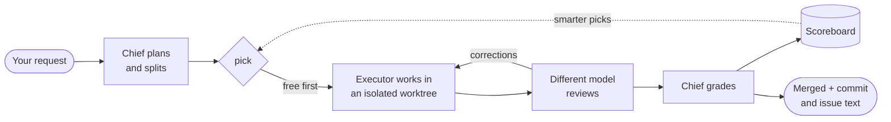

<div align="center">


# agent-crew-chief

**Your coding agent stops working alone and starts running a crew.**

It splits the job, hands each piece to the best *free* model you have, gets a second opinion from a different model, grades every delivery, and learns who to trust in each project.

[](https://github.com/pauloroos/agent-crew-chief/actions/workflows/ci.yml)
[](https://github.com/pauloroos/agent-crew-chief/releases/latest)
[](#install)
[](#install)
[](LICENSE)

**English** · [Português](README.pt-BR.md)

</div>

---

## Why you'd want this

You probably have more AI firepower than you use. There are free models in OpenCode, a quota in Antigravity, a Codex subscription, maybe a third-party key or two. Yet one agent does everything and burns the expensive quota on boilerplate.

**agent-crew-chief** turns the agent you already work in (Claude Code, Codex, OpenCode, Cursor, Antigravity…) into a **crew chief**:

| | |
|---|---|
| 🆓 **Free first** | Free models get the work. Paid ones step in only when the free ones can't deliver, or the task is too complex to split. |
| 🔍 **Real review** | Every delivery is read by a **different model family** before you see it. The chief has the final word. |
| 🏆 **A scoreboard that learns** | Each delivery is graded on how many corrections it needed and how closely it matched the request. Picks improve with every job, per project and per kind of work. |
| 🎲 **No model left behind** | Low scorers and newcomers still get a second chance on low-risk work. Models improve, and the scoreboard notices. |
| 🧱 **Safe by construction** | Isolated git worktrees, a secret filter on every brief, writes outside the worktree auto-rejected, mass-deletion alerts, hard timeouts. |
| 📒 **Everything on record** | Each job leaves a record in your repo, with a commit message and an issue comment ready to paste. |

No server, no daemon, no dependencies: one skill plus a stdlib Python CLI that any agent can drive.

## How it works



1. `job new`: your request is recorded verbatim.
2. `piece add`: it is split into pieces, each with a work type and a risk level.
3. `pick`: an executor is chosen. Free models come first, ranked by decayed score, with an occasional second chance.
4. `dispatch`: the brief runs in a fresh worktree with a hard timeout. Every attempt is recorded, whatever its status.
5. `dispatch --review`: a different model family reviews the work.
6. `correction` + `grade`: the script computes the score, and the scoreboard is rewritten.
7. `accept` / `discard` + `close`: the work lands or is dropped, and you get the commit message and the issue comment.

## Install

```bash
git clone --branch v0.1.0 https://github.com/pauloroos/agent-crew-chief
python agent-crew-chief/install.py /path/to/project
```

No git? Download `agent-crew-chief-v0.1.0.zip` from the
[latest release](https://github.com/pauloroos/agent-crew-chief/releases/latest),
unzip it and run `python install.py /path/to/project` from the unzipped folder.
Pin a tag (`--branch vX.Y.Z`) so you never install code in the middle of a change;
`main` may be ahead of the latest release. See [CHANGELOG.md](CHANGELOG.md).

`install.py` copies the skill into `.claude/skills/crew-chief/` and
`.agents/skills/crew-chief/`, adds a short snippet between
`<!-- BEGIN:agent-crew-chief -->` and `<!-- END:agent-crew-chief -->` to
`AGENTS.md` and `CLAUDE.md` (both created if missing), to `GEMINI.md` (only if it
exists) and to `.cursor/rules/agent-crew-chief.mdc` (only if `.cursor/` exists,
with `alwaysApply: true`). It also creates `docs/crew-chief/preferences.toml`
from the example, plus `docs/crew-chief/jobs/.gitkeep`. It prints every change.

A `CLAUDE.md` that only contains `@AGENTS.md` is left alone. A file whose markers
you removed by hand stays that way; use `--force-snippet` to put the snippet
back:

```bash
python install.py /path/to/project --force-snippet
```

Run the installed CLI:

```bash
python -I .agents/skills/crew-chief/scripts/crew-chief.py discover --project /path/to/project
```

Use `.claude/skills/crew-chief/scripts/crew-chief.py` when that is the copy your
coordinator reads. Every subcommand takes `--project <path>` and `--json`.

## Update

Fetch the new tag and run the installer again:

```bash
cd agent-crew-chief && git fetch --tags && git checkout vX.Y.Z
python install.py /path/to/project
```

The skill files and the snippet are refreshed. Your `preferences.toml`, your
`jobs/` and your `scoreboard.md` are never touched.

## Preferences

Preferences live in `docs/crew-chief/preferences.toml` (created from
`skill/crew-chief/templates/preferences.example.toml`; a full copy with comments
ships in the skill). A global file at
`~/.config/agent-crew-chief/preferences.toml` is always read as well — set
`AGENT_CREW_CHIEF_GLOBAL_PREFS` to point at another location, and a missing file
is fine. Scalar keys are overridden one by one (project wins), and the
`[[tools]]` / `[[models]]` tables are merged by `name` / `match` with the
project winning. A model matched by no rule is `paid`, and a rule with
`cost = "forbidden"` wins at any level: a global `forbidden` beats a project
`free`.

Executor ids look like `<tool>:<model>`, for example
`opencode:opencode-go/longcat-2.5-preview-free`. The fixed vocabularies are work
types `code, tests, refactor, design, docs, research, diagnosis, data, review`,
risk `low, medium, high` and cost `free, paid, forbidden`.

Example:

```toml
# Tools tried for a paid escalation, best first.
strong_order = ["my-claude-proxy", "codex", "claude"]

# Chance (0..1) that low-risk work gets a second chance.
explore_rate = 0.1

# When true, a model with `trains = true` counts as `forbidden`.
forbid_training = false

# fnmatch patterns for paths a brief must never point at.
sensitive_paths = []

# none, github, plane, linear or other.
issue_tracker = "none"

# Hard limit for one dispatch attempt, in seconds.
dispatch_timeout_s = 900

# Executor id used for reviews by default; empty means "choose one".
review_default = ""

[[models]]
match = "opencode:opencode/*-free"
cost = "free"

[[models]]
match = "opencode:opencode-go/*-free"
cost = "free"

[[models]]
match = "antigravity:*"
cost = "free"

[[models]]
match = "*-preview-free"
cost = "free"
trains = true

[[models]]
match = "*contributor*"
cost = "free"
trains = true
```

Every key:

| Key | Meaning |
| --- | --- |
| `strong_order` | Tools tried when the work escalates to a paid model, best first. A tool that is not listed sorts last. |
| `explore_rate` | Chance (0 to 1) that a low-risk piece goes to an unrated or below-median executor instead of the best-scoring one. Default `0.1`. |
| `forbid_training` | When true, a model whose rule sets `trains = true` is treated as `forbidden` and never dispatched. |
| `sensitive_paths` | fnmatch patterns for paths a brief must never point at, for example `[".env", "secrets/*"]`. A brief that names one is refused as `brief_refused`. |
| `issue_tracker` | `none`, `github`, `plane`, `linear` or `other`; used by `close`. |
| `dispatch_timeout_s` | Hard limit for one attempt, in seconds. On overrun the process tree is killed and the attempt is recorded as `timeout`. Default `900`. |
| `review_default` | Executor id used for reviews when the coordinator has no better idea, for example `codex:gpt-5-codex`. Empty means "choose one yourself". |

`[[models]]` rules classify an executor id with fnmatch; the first matching rule
wins:

| Key | Meaning |
| --- | --- |
| `match` | Glob tested against `<tool>:<model>`. |
| `cost` | `free`, `paid` or `forbidden`. |
| `trains` | Whether the provider may train on what you send it. With `forbid_training = true`, such a model becomes `forbidden`. |

`[[tools]]` describes one executor CLI (the built-in tools `opencode`,
`antigravity`, `codex`, `claude` and `cursor` are always present; an entry with
the same `name` replaces the built-in):

| Key | Meaning |
| --- | --- |
| `name` | Unique name; the prefix of the executor id. |
| `kind` | `claude-code`, `opencode`, `codex`, `antigravity` or `generic`. |
| `bin` | Executable to run, looked up on `PATH`. |
| `models` | Fixed list of model ids the tool accepts. Empty means "ask the tool" with `<bin> models`. Kinds `claude-code` and `codex` always use this fixed list. |
| `effort` | Whether the tool takes an effort/reasoning flag. Defaults to true for `codex` and `antigravity`, false otherwise. |
| `env` | Required environment variable names. A name missing from the environment is read from `HKCU\Environment` on Windows. |
| `cost_default` | Cost given to a model that no `[[models]]` rule matched. |
| `run_cmd` | argv template for `kind = "generic"`; the placeholders `{worktree}`, `{model}`, `{prompt}`, `{brief_file}` and `{output_file}` are filled in. |
| `list_cmd` | argv that prints one model id per line, for `kind = "generic"`. |

## Adding a custom CLI

A Claude-Code-like CLI behind a third-party API key:

```toml
[[tools]]
name = "my-claude-proxy"
kind = "claude-code"
bin = "my-claude-proxy"
models = ["<model-id>"]
effort = false
env = ["MY_PROXY_API_KEY"]
cost_default = "paid"
```

`bin` must be on `PATH`; `env` names the variables the tool needs (values are
never printed or stored). Add `[[models]]` rules if the proxy has free models.
Any other CLI can be driven with `run_cmd`:

```toml
[[tools]]
name = "my-generic-cli"
kind = "generic"
bin = "my-generic-cli"
run_cmd = ["my-generic-cli", "run", "--model", "{model}", "{prompt}"]
list_cmd = ["my-generic-cli", "models"]
```

## What gets committed

Everything under `docs/crew-chief/`:

- `preferences.toml` — the resolved preferences for the project;
- `jobs/<job_id>.json` and `jobs/<job_id>.md` — the machine-readable and the
  human-readable record of every job, with attempts, corrections, escalations
  and grades;
- `scoreboard.md` — the decayed ranking per work type.

They belong to the project, so a teammate (or the next session) inherits the
history. Committing them is the point: the scoreboard is only useful if it
survives.

## Scoreboard math

Each graded piece becomes one number — the same one `grade` stores in the job
and `scoreboard.md` ranks by:

```
score = 100 * done / (done + missing)
        - 15 * corrections
        - 5 * extra
        - penalties
score = clamp(round(score), 0, 100)
```

The penalties are 40 for `destructive`, 60 for `outside_write`, 40 for
`false_done` and 30 for `model_mismatch`. When `done + missing == 0` the
adherence term is a full 100.

History is weighted by age with a 30-day half-life: a grade from 30 days ago
counts half as much as today's, one from 60 days ago a quarter as much. The
score shown per executor and work type is the weighted mean of its grades.

Picking is free-first: the best decayed score wins, ties break on the shorter
mean duration, and on low-risk work only there is a 1-in-10 chance
(`explore_rate`, default `0.1`) that an unrated or below-median executor gets a
second chance. No model is ever dropped for good.

## Supported coordinators

Tested: **Claude Code**, **Codex** and **OpenCode**. Expected to work, not yet
tested end to end: **Cursor** and **Antigravity**. The installer writes the
snippet to `AGENTS.md`, `CLAUDE.md`, `GEMINI.md` and the Cursor rule so any
agent that reads one of those picks it up.

## Limitations

- **No real sandbox.** Executors run with their own permissions. Files written
  outside the worktree are detected by comparing snapshots before and after the
  run, and such an attempt is rejected as `outside_write` — after the fact, not
  before.
- **Quotas are text.** A quota or rate-limit failure is detected from the
  executor's own error text (`429`, `quota`, `rate limit`, `usage limit`, `too
  many requests`), so an unusual message is recorded as a plain `failed`.
- **A timeout kills the process tree** (`taskkill /T` on Windows, the process
  group elsewhere) and leaves the worktree for inspection; it cannot undo side
  effects the executor already had outside the worktree.
- The scoreboard is only as good as the grading: a piece that is not graded
  teaches the coordinator nothing.

## License

MIT. See [LICENSE](LICENSE).
