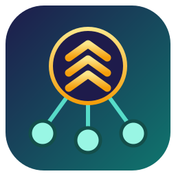

<div align="center">



# agent-crew-chief

**Agentes de código em paralelo, uma spec antes, e uma nota para cada modelo.**

Você dá um pedido ao seu agente. Ele escreve uma spec curta quando o pedido não é pequeno, divide o trabalho em trilhas (uma branch cada), roda as trilhas ao mesmo tempo, com o [Orca](https://github.com/stablyai/orca) ou com worktrees git simples, revisa e dá nota a cada job, e entrega um pull request. As notas dizem qual modelo escolher da próxima vez.

[](https://github.com/pauloroos/agent-crew-chief/actions/workflows/ci.yml)
[](https://github.com/pauloroos/agent-crew-chief/releases/latest)
[](#instalar)
[](#instalar)
[](LICENSE)

[English](README.md) · **Português**

</div>

---

## O que é o ACC

Duas coisas, as duas instaladas no seu projeto:

- **Uma skill** (`crew-chief`) para o agente de código que você já usa: Claude
  Code, Codex, OpenCode, Gemini CLI ou Cursor. O agente com quem você fala vira
  o chefe de equipe; outros agentes, cada um no seu worktree, são os pilotos.
- **Um placar de modelos**, um CLI pequeno em Python sem dependências. Cada job
  recebe uma nota de 0 a 100, e a próxima escolha usa essas notas.

Primeira vez? Faça o [tutorial](docs/tutorial.pt-BR.md) num projeto de exemplo
minúsculo que vem com o ACC.

## O método Pit Wall

O ACC roda cada job como um **Stint**: um piloto no seu worktree de trilha,
verificado por um engenheiro de corrida e depois pelo chefe de equipe.
Mudanças arriscadas ganham olhos independentes antes de serem aceitas, e as
tentativas repetidas começam limpas.

### A equipe

- **Chefe de equipe** (crew chief) — o agente com quem você conversa. Faz a
 spec, planeja, escolhe modelos, segura a parada de aprovação, despacha um
 engenheiro de corrida por trilha, confere os relatórios das trilhas, dá nota
 aos engenheiros, faz o merge e entrega.
- **Engenheiro de corrida** (race engineer) — um por trilha. Coordena só aquela
 trilha: larga os pilotos, roda Stint / Relay / Pneus novos / Vistoria,
 registra notas, manda o relatório da trilha. Brief: `templates/race-engineer.md`.
- **Piloto** (driver) — o agente que faz um job no worktree da trilha.
- **Fiscal** (scrutineer) — revisor só leitura de jobs de risco alto (por ritmo).
 Avaliado como trabalho de `review`.

- **Pneus novos** (Fresh tyres): antes de cada nova tentativa, o worktree da
 trilha volta ao commit que tinha antes do job (`git reset --hard <start>` +
 `git clean -fd`). O próximo piloto nunca herda edições de uma tentativa falha.
- **Relay**: um stint reprovado passa o job adiante. A tentativa 2 usa outro
 modelo (`ACC pick --kind <k> --exclude <falhou>`), mesma faixa permitida; a
 tentativa 3 sobe uma faixa de custo. Depois de três falhas, o engenheiro de corrida
 conserta ou para a trilha.
- **Vistoria** (Scrutineering): jobs de risco alto (auth, dinheiro, perda de
 dados, concorrência) ganham dois fiscais paralelos, só leitura. Nenhum pode
 compartilhar a família de modelos do piloto (é regra, não preferência).
 Achados confirmados voltam para o mesmo modelo do piloto numa sessão nova
 (**pit stop**); cada pit stop é sua própria nota ("(pit stop n)" no título
 do job). No máximo 2 pit stops, depois passa ou Relay. O engenheiro de
 corrida faz sua própria passagem pelo caminho arriscado: uma passagem sem
 achados não é prova. Fiscais que deixam passar um problema real perdem nota;
 cada fiscal é avaliado como trabalho de `review`.
- **Risco** (`low`/`normal`/`high`) é definido por job no plano. Só `high`
 adiciona Vistoria por padrão.
- **Ritmo** (pace) é definido por pedido: `eco` (só grátis), `race` (padrão,
 mais barato bom), `push` (pode começar em included, vistoria em todo job
 não-low). Modelos pagos são usados só quando você diz. Exemplo: "ACC, faz X,
 ritmo push".

| Ritmo | Pilotos | Vistoria | Fiscais | `--max-cost` implícito |
| --- | --- | --- | --- | --- |
| `eco` | só grátis | risco alto | só grátis | `free` |
| `race` | mais barato bom (`ACC pick`) | risco alto | grátis + included | `included` |
| `push` | pode começar em included | todo job exceto low risk | grátis + included | `included` |

Veja `skill/crew-chief/pit-wall.md` para as regras completas.

## Como funciona

```text
pedido
  │
  ├─ pequeno? ────────────────────────────┐
  ▼                                       │
spec: perguntas (≤5) → spec.md, tasks.md  │
  │   commit em acc/<slug>                │
  ▼                                       ▼
trilhas: uma branch cada, acc/<slug>-<trilha>
  │
  ▼
escolhe um modelo por job (ACC pick) ── sua aprovação (só com spec)
  │
  ▼
chefe de equipe despacha um engenheiro de corrida por trilha
  │
  ▼
engenheiros rodam pilotos em paralelo ── acompanha: Orca, ou logs + git
  │
  ▼
engenheiro revisa, registra notas; chefe confere relatórios das trilhas
  │   reprovou → relay com outro modelo
  ▼
merge das trilhas em acc/<slug> → testes → push → pull request (você faz o merge)
```

1. **Spec antes.** Para um pedido que não é pequeno, o chefe de equipe faz as
   perguntas cuja resposta muda o que vai ser feito (no máximo 5, numa mensagem
   só), depois escreve `specs/<NNN>-<slug>/spec.md` e `tasks.md` (e `plan.md`
   quando o desenho não é óbvio) e faz commit deles na branch da feature.
   Pequeno = um job, uma área de arquivos, nenhuma dúvida em aberto: aí não tem spec.
2. **Trilhas.** Jobs que mexem nos mesmos arquivos ou dependem um do outro
   ficam na mesma trilha e rodam em ordem; tarefas marcadas `[P]` sem arquivos
   em comum ganham trilhas próprias e rodam em paralelo. No máximo 4 trilhas.
3. **Escolha.** `ACC pick --kind <tipo>` para cada job (veja [o placar](#o-placar)); se você declarou [seus modelos](#seus-modelos), só eles são candidatos.
4. **Uma parada.** Com spec, o chefe de equipe mostra o resumo da spec, as
   trilhas e os modelos, e espera a sua aprovação. É a única parada; depois
   dela, ele vai até o fim.
5. **Despacha e roda.** O chefe de equipe despacha um engenheiro de corrida por
   trilha. Os engenheiros largam os pilotos nos seus worktrees e esperam em
   verificações curtas (menos de 2 minutos cada) até todo piloto terminar.
6. **Revisa e dá nota.** Cada engenheiro lê cada commit, roda a verificação do
   job e registra notas de piloto e fiscal com `ACC record`. O chefe de equipe
   confere cada relatório de trilha, roda as verificações da trilha e dá nota
   ao engenheiro como trabalho de `coordinate`. Um job reprovado vai para Relay.
7. **Entrega.** As trilhas entram em `acc/<slug>`, os testes do projeto rodam,
   a branch é enviada e um pull request é aberto. Você faz o merge. Engenheiros
   e pilotos nunca fazem push, merge nem abrem pull request.

## Dois modos

O chefe de equipe escolhe no começo de cada execução:

| | Modo Orca | Modo simples |
| --- | --- | --- |
| Quando | `orca status --json` mostra um Orca rodando | nos outros casos, ou quando você pede |
| Onde você roda o chefe de equipe | num terminal do Orca no projeto | qualquer terminal, VS Code, qualquer CLI |
| Trilhas | worktrees do Orca | `git worktree add ../<repo>-acc-<trilha>` |
| Pilotos | `orca orchestration worker-start` | `claude -p`, `codex exec` ou `opencode run` em segundo plano |
| Acompanhamento | painel do Orca, `check --wait`, perguntas dos pilotos | processo vivo, commits novos, arquivos alterados, `../<repo>-acc-logs/*.log` |

No modo simples não há canal de perguntas: um piloto que precisa de uma
resposta para ou chuta, então a spec tem que se bastar. Um job com 30 minutos
sem commit, sem arquivo alterado e sem log crescendo é encerrado e conta como
tentativa reprovada.

## Acompanhar uma rodada

Como você acompanha o progresso e onde os artefatos ficam depende do modo:

- **Com um engenheiro de corrida subagente** (ex.: Claude Code): os relatórios
  das trilhas chegam no chat. No modo Orca, use o painel do Orca e
  `worker-read`.
- **Modo simples:** a pasta `../<repo>-acc-logs/` ao lado do repo guarda os
  artefatos de cada trilha. Arquivos por job: `<trilha>-engineer.md` (o brief
  do engenheiro) e `<trilha>-engineer.log` quando o engenheiro é uma sessão
  CLI; `<trilha>-<job>.md` (spec do job), `.log` e `.log.err` (o opencode
  escreve o progresso em `.err`; o `claude -p` só imprime no final), `.pid`;
  `<trilha>-<job>-scrutineer-<n>-prompt.md` e
  `<trilha>-<job>-scrutineer-<n>.md` (achados, última linha `VERDICT:`); specs
  de pit stop seguem o mesmo padrão. A pasta é apagada na entrega, quando nada
  mais roda.
- **Progresso no git:** `git -C ../<repo>-acc-<trilha> log --oneline acc/<slug>..`.
- **Notas:** `~/.crew-chief/ledger.jsonl`; leia com `ACC score` (modelos
  listados não testados viram `not tried yet (N): ...`), um tipo com
  `--kind`; `ACC models` mostra sua lista com notas e
  `graded but not listed`.
- **O relatório final:** o relatório final do chefe de equipe para você dá o
  link do PR e cada job com risco, ritmo, modelos, tentativas, notas dos
  fiscais, resultado, notas do piloto e do engenheiro, qualquer pendência e
  `ACC score --kind <tipos usados>`.

## O kit de skills

O instalador também copia cinco skills ao lado da `crew-chief`, e toda spec de
job manda os pilotos usarem:

| Skill | De | Para quê |
| --- | --- | --- |
| `test-driven-development` | superpowers | mudanças de código: teste primeiro |
| `systematic-debugging` | superpowers | bugs: achar a causa antes de corrigir |
| `verification-before-completion` | superpowers | rodar a verificação antes de dizer "pronto" (o chefe de equipe também, antes do PR) |
| `ponytail` | ponytail | a menor mudança completa |
| `ponytail-review` | ponytail | uma revisão de qualidade de uma mudança |

Cada cópia leva um arquivo marcador `.installed-by-agent-crew-chief`. Uma pasta
com o mesmo nome mas sem marcador é sua e nunca é tocada. Pule um kit com
`--no-superpowers` ou `--no-ponytail` (cópias que já estão lá ficam como
estão). Um piloto sem as skills lê a regra como orientação simples.

## O placar

As notas ficam em `~/.crew-chief/ledger.jsonl` (ou `$CREW_CHIEF_HOME`), fora
de qualquer repositório: nada aparece nos seus pull requests, e um modelo
avaliado num projeto ajuda a escolha no próximo.

```text
## code

| model | score | n | pass | minutes | cost | last |
| --- | --- | --- | --- | --- | --- | --- |
| opencode:<modelo> | 81.4 | 6 | 83% | 9.5 | free | 2026-10-30 |
| codex:<modelo> (high) | 78.2 | 3 | 100% | 14.0 | included | 2026-10-31 |
```

- **score**: uma média ponderada das notas. Uma nota pesa metade depois de 30
  dias, um quarto depois de 60, para um modelo que mudou na origem se
  recuperar; uma nota imaginária de 50 entra sempre, então um único 100 de
  sorte aparece como 75.
- **n**: jobs avaliados. **pass**: fração de jobs com resultado `pass`.
  **minutes**: média de minutos por job. **last**: data da nota mais recente.
- **cost**: a faixa do último job: `free`, `included` (um plano que você já
  paga), `cheap`, `paid`. Um modelo sem custo registrado conta como o mais caro.

**Como o `pick` escolhe:** entre os modelos com score ≥ 70 em ≥ 2 jobs, ganha
a faixa mais barata (o score maior dentro da faixa). Se nenhum chegou lá
ainda, ele aponta o melhor score até agora (empate vai para o mais barato) e
avisa "not proven yet". `--max-cost` tira antes todo modelo acima daquela faixa.

## Placar em várias máquinas

O ledger (`~/.crew-chief/ledger.jsonl`) é por máquina. Dois jeitos opcionais
de juntar as notas; sem configuração, nada muda.

- **Juntar um arquivo.** Copie o `ledger.jsonl` de outra máquina e rode
  `ACC merge <arquivo>`. Notas novas são adicionadas, duplicadas são puladas
  e rodar de novo adiciona 0.
- **Sincronizar por um repositório git privado.** Em cada máquina, uma vez:
  `ACC sync --init git@github.com:<you>/crew-chief-ledger.git`. Depois,
  `ACC sync` puxa, deduplica e envia. Só o `ledger.jsonl` é compartilhado
  (o `models.toml` fica por máquina porque cada uma acessa modelos diferentes).
  O union merge do git (`.gitattributes`: `ledger.jsonl merge=union`) torna
  acréscimos concorrentes seguros. Usa o acesso git que você já tem; nenhum
  token é pedido, guardado ou criado. O repositório precisa ser privado.

## Seus modelos

Diga ao ACC quais modelos você tem. Dois arquivos opcionais, lidos com o
`tomllib` do Python:

- **global:** `~/.crew-chief/models.toml` (ou `$CREW_CHIEF_HOME/models.toml`);
- **projeto:** `.crew-chief/models.toml` na raiz do repositório. Todo worktree
  lê o arquivo do checkout principal. Faça commit para compartilhar com o
  time, ou coloque no `.gitignore`.

```toml
[[model]]
agent  = "opencode"          # CLI / agente do Orca: opencode, claude, codex, gemini, cursor, ...
model  = "provider/model-a"  # o valor exato do --model
cost   = "free"              # free | included | cheap | paid
kinds  = ["code", "tests"]   # opcional; ausente = todos os tipos
note   = "dia a dia"         # opcional; mostrado ao chefe de equipe
```

A lista global e a do projeto se juntam. Uma entrada do projeto com o mesmo
`agent` e `model` muda só os campos que ela define (`enabled = false` desliga
aquele modelo aqui); `inherit = false` no arquivo do projeto ignora a lista
global. `ACC models` mostra a lista efetiva: de onde veio cada modelo, as
notas e as observações. Depois da tabela ele imprime
`graded but not listed: <agent:model> (<kind> <score>, n <n>)` para executores
que têm notas mas não estão no `models.toml`, para você poder adicioná-los.
Com uma lista, o `ACC pick` e o chefe de equipe escolhem só entre esses modelos;
um modelo sem nota ainda é testado, e a nota que você registrar decide. Sem
nenhum arquivo, nada muda. Um arquivo quebrado para o comando com
`<caminho>: <problema>`. Um exemplo para copiar está em
[`examples/models.toml`](examples/models.toml).

O arquivo guarda só nomes. Nunca coloque chaves ou tokens nele; o ACC não lê
nenhum campo secreto.

## Usando

Fale com o seu agente; comece com "ACC". Exemplos de pedido:

- Correção pequena (sem spec): *"ACC, corrige o erro de um a mais no
  `paginate()` em `src/api/list.py` e adiciona um teste."*
- Feature (spec, uma parada para aprovar): *"ACC, adiciona exportação CSV na
  página de relatórios: um botão, um endpoint e testes."*
- Pesquisa ou revisão: *"ACC, revisa o módulo de autenticação atrás de
  problemas de segurança e compara dois modelos nisso."* / *"ACC, pesquisa como
  poderíamos fazer cache dos resultados da busca; sem mudar código."*

Conduzindo uma execução:

- **Pular a spec:** diga "sem spec" (ou "run directly").
- **Forçar o modo simples:** diga "sem Orca" (ou "modo simples").
- **Limitar custo:** diga "só modelos grátis" ou "nada acima de included"; o
  chefe de equipe passa `--max-cost free|included|cheap|paid` para o `ACC pick`.

Os cinco comandos. `ACC` é `python -I .agents/skills/crew-chief/scripts/crew-chief.py`
(ou `.claude/skills/...`) num projeto com a skill instalada:

```text
ACC models [--json]            # seus modelos declarados, com as notas deles
ACC pick --kind code [--max-cost free|included|cheap|paid] [--json]
ACC record --kind code --agent opencode --model <modelo> --cost free --outcome pass --score 85 --minutes 12 [--effort <e>] [--lane <trilha>] [--job "<título>"] [--note "<por quê>"]
ACC score [--kind code] [--project <nome>] [--json]
ACC import /caminho/do/projeto     # notas guardadas pelo ACC 0.6 em docs/crew-chief/jobs
ACC merge <arquivo>                # junta um ledger copiado de outra máquina
ACC sync [--init <url>]            # sincroniza o ledger.jsonl por um repo git privado
```

Tipos: `code`, `tests`, `refactor`, `design`, `docs`, `research`,
`diagnosis`, `data`, `review`, `coordinate`.

## Instalar

Você precisa de Python 3.11+, git e pelo menos um CLI de agente (`claude`,
`codex` ou `opencode`). O [Orca](https://github.com/stablyai/orca) é opcional.

```bash
git clone --branch v0.11.1 https://github.com/pauloroos/agent-crew-chief
python agent-crew-chief/install.py /caminho/do/projeto
```

Sem git? Baixe `agent-crew-chief-v0.11.1.zip` das
[releases](https://github.com/pauloroos/agent-crew-chief/releases/tag/v0.11.1),
descompacte e rode `python install.py /caminho/do/projeto` na pasta descompactada.

O `install.py` copia a skill e o kit para `.claude/skills/`, `.agents/skills/`
e `.gemini/skills/`, e põe um trecho curto entre
`<!-- BEGIN:agent-crew-chief -->` e `<!-- END:agent-crew-chief -->` no
`AGENTS.md` e no `CLAUDE.md`, no `GEMINI.md` (só se existir) e em
`.cursor/rules/agent-crew-chief.mdc` (só se `.cursor/` existir). Um
`CLAUDE.md` que só contém `@AGENTS.md` fica como está; `--force-snippet`
recoloca um trecho cujos marcadores você removeu. Faça commit dos arquivos
instalados, para todo worktree de trilha ter as skills também.

Para todos os repositórios da máquina de uma vez (em `~/.claude`, `~/.agents`,
`~/.gemini`; as mesmas flags `--no-superpowers` / `--no-ponytail`, mais `--dry-run`):

```bash
python -I agent-crew-chief/skill/crew-chief/scripts/install_machine_wide.py
```

Depois é só dizer ao seu agente "ACC, faz X".

## Atualizar

```bash
git -C agent-crew-chief fetch --tags
git -C agent-crew-chief checkout v0.11.1
python agent-crew-chief/install.py /caminho/do/projeto
```

O instalador troca as próprias cópias e o próprio trecho; arquivos que só
diferem no fim de linha ficam como estão. O ledger em `~/.crew-chief/` nunca é
tocado.

## Vindo da 0.6 ou da 0.7

- **Da 0.7:** rode o instalador de novo. Você ganha a etapa de spec, o kit e o
  modo simples; o placar é o mesmo arquivo.
- **Da 0.6:** o maestro, o motor de despacho, os slots e as preferências por
  projeto não voltam. As cópias do kit que a 0.6 instalou têm o mesmo marcador
  e são atualizadas no lugar. Traga as notas antigas para o placar uma vez com
  `ACC import <projeto>`; depois a pasta `docs/crew-chief/` antiga pode ser apagada.

## Créditos

O kit vem incluído no repositório sob as próprias licenças MIT (versões no
arquivo `VERSION` de cada um):

- [superpowers](https://github.com/obra/superpowers) v7.0.1, de Jesse Vincent:
  veja [vendor/superpowers/LICENSE](vendor/superpowers/LICENSE).
- [ponytail](https://github.com/DietrichGebert/ponytail) v5.3.2, de
  DietrichGebert: veja [vendor/ponytail/LICENSE](vendor/ponytail/LICENSE).

## Licença

MIT. Veja [LICENSE](LICENSE) e [CHANGELOG.md](CHANGELOG.md).
