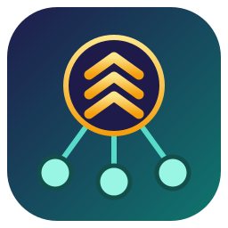

<div align="center">



# agent-crew-chief

**Agentes em paralelo pelo Orca, e uma nota para cada modelo.**

Você dá um pedido ao seu agente. Ele divide o trabalho em trilhas, uma branch cada, roda as trilhas ao mesmo tempo como workers do [Orca](https://github.com/stablyai/orca), acompanha, revisa e dá nota a cada job, e entrega um pull request. As notas dizem qual modelo escolher da próxima vez.

[](https://github.com/pauloroos/agent-crew-chief/actions/workflows/ci.yml)
[](https://github.com/pauloroos/agent-crew-chief/releases/latest)
[](#instalar)
[](#instalar)
[](LICENSE)

[English](README.md) · **Português**

</div>

---

## Como funciona

1. **Trilhas.** O coordenador (o agente com quem você fala) divide o pedido em
   jobs e agrupa os jobs em trilhas. Jobs que mexem nos mesmos arquivos ficam na
   mesma trilha e rodam em ordem; trilhas que não se cruzam rodam em paralelo.
   Cada trilha é uma branch num worktree do Orca.
2. **Escolha.** Para cada job ele pergunta `ACC pick --kind <tipo>`: o modelo
   mais barato que tirou nota boa pelo menos duas vezes naquele tipo de trabalho.
3. **Roda e acompanha.** O Orca sobe os workers (`orca orchestration
   worker-start`) e o coordenador espera os relatos deles (`check --wait`).
4. **Revisa e dá nota.** O coordenador lê cada commit, roda a verificação do job
   e registra uma nota de 0 a 100 com `ACC record`. Um job reprovado vai para
   outro modelo junto com os achados.
5. **Entrega.** As trilhas entram na branch da feature, são testadas, enviadas
   e viram um pull request. Você faz o merge.

O Orca roda e monitora. O ACC é o método (a skill) mais um placar pequeno (o
CLI), sem dependências.

## O placar

As notas ficam em `~/.crew-chief/ledger.jsonl`, fora de qualquer repositório:
nada aparece nos seus pull requests, e um modelo avaliado num projeto ajuda a
escolha no próximo. Cada nota é uma média das notas dos jobs em que os jobs
recentes pesam mais (metade depois de 30 dias), e uma nota imaginária de 50
impede que um único 100 de sorte pareça perfeito.

```text
ACC pick --kind code [--max-cost free|included|cheap|paid]
ACC record --kind code --agent opencode --model <modelo> --cost free --outcome pass --score 85 --minutes 12
ACC score [--kind code] [--project <nome>]
ACC import /caminho/do/projeto     # notas guardadas pelo ACC 0.6 em docs/crew-chief/jobs
```

`ACC` é `python -I .agents/skills/crew-chief/scripts/crew-chief.py` num projeto
com a skill instalada.

## Instalar

Você precisa do [Orca](https://github.com/stablyai/orca) rodando e de Python 3.11+.

```bash
git clone --branch v0.7.0 https://github.com/pauloroos/agent-crew-chief
python agent-crew-chief/install.py /caminho/do/projeto
```

Sem git? Baixe `agent-crew-chief-v0.7.0.zip` da
[última release](https://github.com/pauloroos/agent-crew-chief/releases/latest),
descompacte e rode `python install.py /caminho/do/projeto` na pasta descompactada.

O `install.py` copia a skill para `.claude/skills/crew-chief/`,
`.agents/skills/crew-chief/` e `.gemini/skills/crew-chief/`, e põe um trecho curto
entre `<!-- BEGIN:agent-crew-chief -->` e `<!-- END:agent-crew-chief -->` no
`AGENTS.md` e no `CLAUDE.md`, no `GEMINI.md` (só se existir) e em
`.cursor/rules/agent-crew-chief.mdc` (só se `.cursor/` existir). Um `CLAUDE.md`
que só contém `@AGENTS.md` fica como está; `--force-snippet` recoloca um trecho
cujos marcadores você removeu.

Para todos os repositórios da máquina de uma vez:

```bash
python -I agent-crew-chief/skill/crew-chief/scripts/install_machine_wide.py
```

Depois é só dizer ao seu agente "ACC, faz X".

## Vindo da 0.6

A 0.7 tira o maestro, o motor de despacho, o worktree por tentativa, a
entrevista, o modo guiado por spec, os kits e as preferências por projeto: quem
roda os agentes agora é o Orca. A sua pasta `docs/crew-chief/` antiga fica como
está; `ACC import <projeto>` traz as notas dela para o placar novo, e depois você
pode apagar a pasta.

## Licença

MIT. Veja [LICENSE](LICENSE) e [CHANGELOG.md](CHANGELOG.md).
