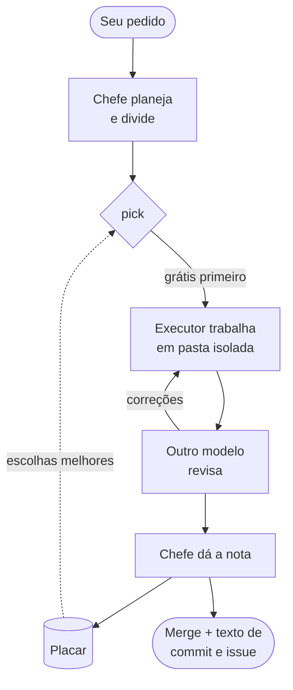

<div align="center">


# agent-crew-chief

**Seu agente de código para de trabalhar sozinho e passa a chefiar uma equipe.**

Ele divide o trabalho, entrega cada pedaço ao melhor modelo *grátis* que você tem, pede uma segunda opinião a outro modelo, dá nota a cada entrega e aprende em quem confiar em cada projeto.

[](https://github.com/pauloroos/agent-crew-chief/actions/workflows/ci.yml)
[](https://github.com/pauloroos/agent-crew-chief/releases/latest)
[](#instalação)
[](#instalação)
[](LICENSE)

[English](README.md) · **Português**

</div>

---

## Por que usar

Você provavelmente tem mais poder de IA do que usa: modelos grátis no OpenCode, cota no Antigravity, assinatura do Codex, talvez uma chave de terceiro. Mesmo assim, um agente só faz tudo e queima a cota cara em trabalho braçal.

O **agent-crew-chief** transforma o agente em que você já trabalha (Claude Code, Codex, OpenCode, Cursor, Antigravity…) num **chefe de equipe**:

| Recurso | O que você ganha |
|---|---|
| 🆓 **Grátis primeiro** | Os modelos grátis pegam o trabalho. Os pagos só entram quando os grátis não dão conta, ou quando a tarefa é complexa demais para dividir. |
| 🔍 **Revisão de verdade** | Toda entrega é lida por um modelo de **outra família** antes de chegar a você. A palavra final é do chefe. |
| 🏆 **Placar que aprende** | Cada entrega ganha nota pelo número de correções e pela fidelidade ao pedido. As escolhas melhoram a cada trabalho, por projeto e por tipo de serviço. |
| 🎲 **Ninguém fica para trás** | Modelos com nota baixa e modelos novos ainda ganham segunda chance em tarefa de risco baixo. Modelos melhoram, e o placar percebe. |
| 🧱 **Seguro por construção** | Pasta git isolada, filtro de segredos em cada brief, escrita fora da pasta rejeitada na hora, alerta de deleção em massa, limite de tempo. |
| 📒 **Tudo registrado** | Cada trabalho deixa um registro no seu repositório, com mensagem de commit e comentário de issue prontos para colar. |

Sem servidor, sem processo de fundo, sem dependências: uma skill e um CLI Python puro que qualquer agente consegue usar.

Começando agora? Siga os [tutoriais](docs/tutorials/README.pt-BR.md): seu primeiro job em 10 minutos, trabalho guiado por spec, e custo e segurança, com um projeto de treino em [`examples/hello-crew`](examples/hello-crew).

## Como funciona



1. `job new`: o pedido é registrado palavra por palavra.
2. `piece add`: ele é dividido em pedaços, cada um com tipo de trabalho e nível de risco.
3. `pick`: o executor é escolhido. O trabalho braçal (`code`, `tests`, `refactor`, `docs`, `data`) começa pelos modelos grátis, OpenCode primeiro; quando não sobra nenhum, o `pick` ainda pode escolher um `included` ou um `cheap` dentro do orçamento, e o degrau `paid` exige `--strong`. O trabalho de pensar (`review`, `design`, `diagnosis`, `research`) sobe a mesma escada e só chega a `paid` quando é preciso. Dentro disso decide a nota com decaimento, e às vezes alguém ganha segunda chance. Empates são espalhados pelo job, e um modelo que acabou de bater cota fica de fora por um tempo.
4. `dispatch`: o brief roda numa pasta nova com limite de tempo. Toda tentativa fica registrada, qualquer que seja o resultado, com duração, passos do agente e tokens. Uma tentativa que termina sem erro mas não muda nada fica `no_change`, que conta como falha, não como `ok`. Peças independentes podem ser despachadas em paralelo.
5. `pick --review` + `dispatch --review`: um modelo fora da família de cota do executor revisa o trabalho.
6. `correction` + `grade`: o script calcula a nota, e o placar é reescrito. Depois de uma correção, o próximo `dispatch` parte do branch da última tentativa `ok`, então o brief descreve só o ajuste e o diff mostra só ele (`--fresh` recomeça do `HEAD`, `--base <n|branch>` escolhe a tentativa de partida). Cada executor que trabalhou na peça fica com a própria nota.
7. `accept` / `discard` + `close`: o trabalho entra ou é descartado, e você recebe a mensagem de commit e o comentário da issue, que listam cada executor com sua nota.

## Trabalho guiado por especificação (opcional)

Para uma funcionalidade com vários requisitos, o pedido pode morar numa pasta de
especificação em vez de um parágrafo. O crew-chief lê o formato do
[spec-kit](https://github.com/github/spec-kit) (`specs/NNN-slug/` com `spec.md`,
`plan.md` e `tasks.md`) e transforma as tarefas em peças. Testado com
spec-kit 1.2.x. Não precisa do spec-kit instalado, nunca cria `.specify/` e
nunca edita `spec.md` nem `plan.md`. A gramática foi reimplementada; nenhum
template do spec-kit foi copiado.

O coordenador dimensiona o processo ao pedido: uma edição **trivial** não tem job
nem spec, um pedido **pequeno** tem só o job, e um **projeto** segue o ciclo
abaixo.

```bash
crew-chief spec new --title "Exportar CSV"                  # ou use uma pasta spec-kit que já existe
crew-chief spec import --job <id> --spec-dir specs/001-exportar-csv
crew-chief spec status --job <id>                           # progresso, tarefas prontas e bloqueadas
crew-chief brief render --job <id> --piece 3 --out brief.md # depois pick + dispatch
crew-chief brief render --job <id> --piece 3 --review --out review.md
crew-chief brief render --job <id> --converge --out converge.md
crew-chief ruling add --job <id> --text "<decisão> — <por quê> — <custo se errar>"
crew-chief decision add --job <id> --from-ruling 1
crew-chief usage add --job <id> --role coordinator --tokens-in 52000 --tokens-out 9000
crew-chief economy --job <id>
```

(`crew-chief` representa `python -I .agents/skills/crew-chief/scripts/crew-chief.py`.)

- **Importação.** O `spec import` transforma cada tarefa aberta do `tasks.md` numa
  peça (`ref` = o id da tarefa; tarefas `[X]` são puladas) e mantém um arquivo
  auxiliar, o `crew.toml`, ao lado dele. O spec-kit não tem lugar para os dados
  que o executor precisa, então o `crew.toml` guarda: uma tabela `[tasks.T012]`
  por tarefa, com `type`, `risk`, `accept` (referências como `FR-001` ou `US1/AC1`
  dentro do `spec.md`), `files` que ela pode mudar, um comando `proof`, um texto
  `expect` opcional, `depends` e `interfaces`; a lista `global_constraints` no
  topo vale para todas as tarefas. O `import` avisa sobre tarefas sem prova,
  entradas do `crew.toml` e peças cujo id de tarefa sumiu, tarefas `[P]` da mesma
  fase que dividem arquivos e **peças desatualizadas**: quando o `tasks.md` é
  regenerado e o texto de uma tarefa muda, a peça dela é recusada pelo `dispatch`
  e pelo `brief render` até você corrigir a spec e importar de novo. Cada
  entrada do `crew.toml` também guarda o texto da tarefa para a qual foi escrita
  (`task`); quando o spec-kit renumera e aquele id passa a ser outra tarefa, o
  `import` avisa `crew.toml entry T012 was written for another task; review it`,
  e o `dispatch` e o `brief render` recusam a tarefa até você corrigir a entrada
  e pôr no `task` o texto atual. (Entradas escritas antes do `task` existir não
  têm como ser conferidas.) O `import` edita o `crew.toml` no lugar, então seus
  comentários ficam; uma chave desconhecida é erro. Um job fica preso à primeira
  pasta de spec.
- **Briefs.** O `brief render` escreve o mínimo que o executor precisa: a tarefa,
  os critérios de aceite a que ela se refere (o texto deles, não a spec inteira),
  as restrições, as interfaces, os arquivos permitidos e a prova. Com `--review`
  escreve o brief do revisor, que pede dois veredictos: spec (`done`, `missing`,
  `misunderstood`, `extra`) e qualidade (`Critical`, `Important`, `Minor`). O
  brief de revisão fica preso a uma tentativa (`--attempt N`, por padrão a
  última `ok`): a worktree, o commit de início e o de fim, para o revisor
  conferir o `HEAD` certo. O `dispatch --review` imprime a resposta do revisor.
  O `--converge` escreve a última passada, que compara o código com a spec inteira e
  lista as lacunas que ainda não são tarefas, ou responde `Converged`.
- **Prova.** Depois de uma tentativa `ok`, o `dispatch` roda a `proof` da tarefa na
  worktree. Uma prova que falha ou estoura o tempo deixa a tentativa como
  `proof_failed`, com a saída na nota, e conta como falha. Peças braçais sem prova
  são recusadas (`--no-proof` pula e registra isso). Uma peça cuja dependência ou
  fase anterior ainda não foi aceita é recusada (`--ignore-deps` libera e
  registra). Arquivos mudados fora dos `files` da tarefa aparecem numa linha
  `scope:`. Peças sem tarefa de spec funcionam como antes e não exigem prova.
- **Aceite.** O `accept` marca a tarefa `[X]` no `tasks.md`; CRLF, BOM e o resto
  do arquivo ficam como estão. Quando o `tasks.md` é versionado e não tem outras
  mudanças, a marcação vira um commit só dela (`docs(tasks): mark T012 done`);
  senão fica sem commit e o `accept` avisa.
- **Decisões.** O `ruling add` registra uma decisão de uma linha no job. O
  `decision add` grava essa decisão, ou um título que você der, em
  `docs/decisions/NNNN-slug.md` como um ADR com contexto, alternativas e
  consequências.
- **Fechamento.** O `close` também põe o job no CHANGELOG do projeto (veja a
  preferência `changelog`) e imprime o bloco de economia. O `close --type fix`
  (ou um título de job `fix: ...`) faz dele uma correção na mensagem de commit e
  no CHANGELOG.

### Economia

Delegar só compensa se o trabalho grátis não for comido pelo gasto do próprio
coordenador, por retrabalho ou por demora. O `usage add` registra os tokens do
coordenador (`--role coordinator`, ou `central` para uma sessão acima dele)
quando a CLI dele informa. O `economy` e o `close` imprimem a fatia de peças e de
tokens que foi para executores grátis, a fatia do coordenador, tentativas por
peça e a nota média, e uma linha `alert:` para cada limite ultrapassado. A
duração do job fica no registro do job (a linha `Time` do `.md`) e é o que o
`alert_job_minutes` confere:

| Preferência | Padrão | Alerta |
| --- | --- | --- |
| `alert_coordinator_share` | `0.5` | o coordenador gastou mais que essa fatia de todos os tokens |
| `alert_attempts_per_piece` | `2.5` | mais tentativas de execução por peça que isso |
| `alert_job_minutes` | `180` | o job demorou mais que isso |

`0` desliga um alerta. A skill manda o coordenador ler os alertas: se ele gasta
mais do que delega, deve dividir menos e fazer o trabalho direto.

### Degraus de custo, o teto e o `setup`

Todo executor fica numa escada de quatro degraus, do mais barato ao mais caro;
`forbidden` fica fora dela:

| Degrau | Significado | Quando o `pick` usa |
| --- | --- | --- |
| `free` | Sem dinheiro e sem assinatura (prévias grátis, modelos contributor, cota do Antigravity) | Primeiro, em toda peça |
| `included` | Coberto por uma assinatura que você já paga (um plano Codex ou Claude) | Quando não sobra executor grátis para a peça |
| `cheap` | Pago por uso (OpenRouter, modelos pagos do OpenCode) | Só enquanto o gasto do dia estiver abaixo de `cheap_budget_usd_day` |
| `paid` | Pago por uso, o recurso forte | Só trabalho de pensar, ou qualquer trabalho com `--strong` |

O `pick` sobe um degrau só quando um degrau acaba — nunca só porque um executor
grátis falhou. Trabalho braçal nunca chega a `paid` sem `--strong`; com ele,
`included` e `cheap` ainda são tentados antes. As tentativas começam no esforço
mais baixo que serve à peça, e uma tentativa `quota` ou `brief_refused` não sobe
esse teto. Rode o CLI como coordenador com `--coordinator <tool>` (padrão
`$CREW_CHIEF_COORDINATOR`) para o `pick` usar o seu próprio CLI — ou a família
de assinatura dele — por último entre os `included`; `--allow-own-cli` desliga
isso.

O `setup` lê a máquina e escreve os degraus para você:

```bash
crew-chief setup --project .          # pergunta uma coisa de cada vez
crew-chief setup --yes --project .    # não pergunta nada: assinaturas não, teto 0, sem treino
```

Ele encontra os CLIs no `PATH`, seus modelos e o tipo de cada login (conta ou
chave de API — nunca o valor), pergunta só o que não consegue deduzir, imprime a
contagem por degrau e escreve um bloco gerenciado em
`~/.config/agent-crew-chief/preferences.toml`, entre `# >>> acc setup >>>` e
`# <<< acc setup <<<`, sem tocar no resto do arquivo. Precisa de um terminal, a
menos que use `--yes`; nunca guarda o valor de uma chave, só o tipo de login e
os nomes das variáveis de ambiente. `--lang pt|en` escolhe o idioma (padrão: o
idioma do sistema). Enquanto não existe bloco, o `discover` imprime
`run setup to configure cost tiers`. **Numa primeira instalação, rode
`setup --yes`.**

Toda tentativa `cheap` ou `paid` grava uma linha JSON em `spend.jsonl`, ao lado
do arquivo global de preferências, seja qual for o projeto. O `pick` e o
`dispatch` o leem antes de gastar: `cheap_budget_usd_day` é o teto diário entre
projetos (`0` mantém o degrau barato fechado), `cheap_budget_usd_job` limita um
job e uma regra `[[models]]` pode ter `cap_usd_day` para limitar um executor.
Dois limites honestos: uma tentativa pode passar do teto diário em no máximo o
próprio custo (a checagem acontece antes da tentativa) e várias tentativas ao
mesmo tempo podem passar na checagem e, juntas, estourar o teto. Não há limite
de tokens por tentativa, porque nenhum CLI suportado aceita um. Um modelo barato
de custo desconhecido, sem `cap_usd_day`, ganha uma tentativa de sondagem por
executor por dia (só enquanto o teto está aberto); depois disso fica fechado até
você definir um teto.

Os `sensitive_paths` do projeto escondem arquivos e pastas de uma worktree de
execução: cada entrada é um prefixo de caminho ou um curinga fnmatch, e um
prefixo como `.env` também esconde `.env.example`. Um brief que cita um caminho
sensível é recusado como `brief_refused`, e a worktree é checada de novo depois
da execução — um caminho achado ali é anotado na tentativa.

### Junto com o superpowers

Se as skills do [superpowers](https://github.com/obra/superpowers) também estão
instaladas, use-as para conversar e desenhar; use o crew-chief para executar o
plano. O trecho instalado diz isso numa linha.

## Ponytail

O [Ponytail](https://github.com/DietrichGebert/ponytail) (MIT, de DietrichGebert)
v5.3.2 vem dentro do crew-chief: as duas skills `ponytail` e `ponytail-review`,
vendorizadas em `vendor/ponytail/`. Ponytail é o conjunto de regras do "dev sênior
preguiçoso" — a menor mudança que resolve a tarefa por inteiro, sem opção que
ninguém pediu.

O `install.py` copia as duas skills para `.claude/skills/` e `.agents/skills/` e
marca cada pasta com `.installed-by-agent-crew-chief`. Uma pasta `ponytail` sem
essa marca é de outra pessoa: fica como está e o instalador avisa. `--no-ponytail`
pula a cópia e nunca remove uma pasta que já existe:

```bash
python install.py /caminho/do/projeto --no-ponytail
```

Quanto disso chega ao brief é a preferência `ponytail_level`:

- `lite` — construa o que foi pedido; cite uma opção menor em uma linha.
- `full` (padrão) — a menor mudança completa.
- `ultra` — questione também o pedido e conteste o que ele não justifica; pode
  fazer um modelo barato discutir em vez de construir.
- `off` — nenhum Ponytail em brief nenhum.

Um brief de execução ganha uma seção `## Style (ponytail <level>)`, e um brief de
revisão conta inchaço como achado `Important`; `off` remove os dois.

## Instalação

```bash
git clone --branch v0.3.5 https://github.com/pauloroos/agent-crew-chief
python agent-crew-chief/install.py /caminho/do/projeto
```

Sem git? Baixe o `agent-crew-chief-v0.3.5.zip` da
[última release](https://github.com/pauloroos/agent-crew-chief/releases/latest),
descompacte e rode `python install.py /caminho/do/projeto` de dentro da pasta.
Fixe uma tag (`--branch vX.Y.Z`) para nunca instalar código no meio de uma mudança;
o `main` pode estar à frente da última release. Veja o [CHANGELOG.md](CHANGELOG.md).

O `install.py` copia a skill para `.claude/skills/crew-chief/` e
`.agents/skills/crew-chief/`, insere um trecho curto entre
`<!-- BEGIN:agent-crew-chief -->` e `<!-- END:agent-crew-chief -->` no `AGENTS.md`
e no `CLAUDE.md` (criados se faltarem), no `GEMINI.md` (só se existir) e em
`.cursor/rules/agent-crew-chief.mdc` (só se `.cursor/` existir, com
`alwaysApply: true`). Também cria `docs/crew-chief/preferences.toml` a partir do
exemplo, além de `docs/crew-chief/jobs/.gitkeep`. Ele imprime cada alteração.

Um `CLAUDE.md` que só contém `@AGENTS.md` é deixado como está. Um arquivo cujos
marcadores você removeu à mão continua assim; use `--force-snippet` para
recolocar o trecho:

```bash
python install.py /caminho/do/projeto --force-snippet
```

Rode o CLI instalado:

```bash
python -I .agents/skills/crew-chief/scripts/crew-chief.py discover --project /caminho/do/projeto
```

Use `.claude/skills/crew-chief/scripts/crew-chief.py` quando for essa a cópia que
o seu coordenador lê. Todo subcomando aceita `--project <caminho>` e `--json`.

## Atualização

Baixe a tag nova e rode o instalador de novo:

```bash
cd agent-crew-chief && git fetch --tags && git checkout vX.Y.Z
python install.py /caminho/do/projeto
```

Os arquivos da skill e o trecho são atualizados. Seu `preferences.toml`, seus
`jobs/`, seu `scoreboard.md` e seu `models-seen.json` nunca são tocados.

## Preferências

As preferências ficam em `docs/crew-chief/preferences.toml` (criado a partir de
`skill/crew-chief/templates/preferences.example.toml`; uma cópia completa com
comentários vem junto com a skill). Um arquivo global em
`~/.config/agent-crew-chief/preferences.toml` também é sempre lido — defina
`AGENT_CREW_CHIEF_GLOBAL_PREFS` para apontar para outro lugar, e um arquivo
ausente não é problema. Chaves escalares são sobrescritas uma a uma (o projeto
vence), e as tabelas `[[tools]]` / `[[models]]` são mescladas por `name` /
`match` com o projeto vencendo. Um modelo que não casa com nenhuma regra é
`paid`, e uma regra com `cost = "forbidden"` vence em qualquer nível: um
`forbidden` global bate um `free` do projeto.

Os ids de executor têm o formato `<tool>:<model>`, por exemplo
`opencode:opencode-go/longcat-2.5-preview-free`. Os vocabulários fixos são os
tipos de trabalho `code, tests, refactor, design, docs, research, diagnosis,
data, review`, o risco `low, medium, high` e o custo `free, included, cheap,
paid, forbidden`.

Exemplo:

```toml
# Ferramentas tentadas na escalada paga, da melhor para a pior.
strong_order = ["my-claude-proxy", "codex", "claude"]

# Chance (0 a 1) de trabalho de risco baixo ganhar uma segunda chance.
explore_rate = 0.1

# Quando true, um modelo com `trains = true` conta como `forbidden`.
forbid_training = false

# Padrões fnmatch de caminhos que um brief nunca pode citar.
sensitive_paths = []

# none, github, plane, linear ou other.
issue_tracker = "none"

# Limite rígido de uma tentativa de dispatch, em segundos.
dispatch_timeout_s = 900

# Id de executor usado por padrão nas revisões; vazio significa "escolha um".
review_default = ""

# Horas depois das quais pick/dispatch voltam a checar modelos novos ou sumidos.
model_check_hours = 24

# Minutos que um executor fica fora do pick depois de uma tentativa `quota`.
quota_cooldown_min = 60

# Ferramentas cujos executores grátis vêm primeiro no trabalho braçal.
exec_first = ["opencode"]

# Entradas extras do home (fnmatch) que a checagem de escrita externa ignora,
# além da lista embutida de pastas de CLIs de agente (.claude, .codex, .gemini,
# .config, ...).
ignore_home_entries = []

[[models]]
match = "opencode:opencode/*-free"
cost = "free"

[[models]]
match = "opencode:opencode-go/*-free"
cost = "free"

[[models]]
match = "antigravity:*"
cost = "free"

[[models]]
match = "*-preview-free"
cost = "free"
trains = true

[[models]]
match = "*contributor*"
cost = "free"
trains = true
```

Todas as chaves:

| Chave | Significado |
| --- | --- |
| `strong_order` | Ferramentas tentadas quando o trabalho escala para um modelo pago, da melhor para a pior. Uma ferramenta não listada vai para o fim. |
| `explore_rate` | Chance (de 0 a 1) de uma parte de risco baixo ir para um executor sem histórico ou abaixo da mediana em vez do melhor colocado. Padrão `0.1`. |
| `forbid_training` | Quando true, um modelo cuja regra define `trains = true` é tratado como `forbidden` e nunca é despachado. |
| `sensitive_paths` | Padrões fnmatch e prefixos de caminho que um brief nunca pode citar, por exemplo `[".env", "secrets/*"]`. Um brief que cita um deles é recusado como `brief_refused`; os arquivos rastreados também são escondidos de uma pasta de execução. Um prefixo como `.env` também esconde `.env.example`. |
| `issue_tracker` | `none`, `github`, `plane`, `linear` ou `other`; usado pelo `close`. |
| `changelog` | `keep-a-changelog` (padrão) ou `none`. O `close` põe o job no CHANGELOG do projeto em `## [Unreleased]` (`Added` para feat, `Fixed` para fix, `Changed` para refactor e perf), uma vez por job, mantendo CRLF e BOM; docs, tests e chores não geram entrada. `close --no-changelog` pula. |
| `changelog_path` | Arquivo do CHANGELOG, relativo ao projeto. Padrão `CHANGELOG.md`. |
| `alert_coordinator_share` | Alerta quando o coordenador gastou mais que essa fatia (0 a 1) dos tokens de um job. Padrão `0.5`; `0` desliga. |
| `alert_attempts_per_piece` | Alerta quando um job tem, em média, mais tentativas de execução por peça que isso. Padrão `2.5`; `0` desliga. |
| `alert_job_minutes` | Alerta quando um job demorou mais que esses minutos. Padrão `180`; `0` desliga. |
| `cheap_budget_usd_day` | Teto diário, em dólares, para modelos `cheap` em todos os projetos. `0` (padrão) mantém o degrau barato fechado. Uma tentativa pode passar do teto em no máximo o próprio custo. |
| `cheap_budget_usd_job` | Teto, em dólares, para modelos `cheap` em um job. `0` (padrão) significa sem teto por job. |
| `dispatch_timeout_s` | Limite rígido de uma tentativa, em segundos. Ao estourar, a árvore de processos é morta e a tentativa é registrada como `timeout`. Padrão `900`. |
| `review_default` | Id de executor usado nas revisões quando o coordenador não tem ideia melhor, por exemplo `codex:gpt-5-codex`. Vazio significa "escolha um você mesmo" (`pick --review`). |
| `exec_first` | Ferramentas cujos executores grátis o `pick` tenta primeiro no trabalho braçal (`code`, `tests`, `refactor`, `docs`, `data`), antes dos outros grátis. Padrão `["opencode"]`; `[]` desliga. |

As regras `[[models]]` classificam um id de executor com fnmatch; a primeira
regra que casa vence:

| Chave | Significado |
| --- | --- |
| `match` | Glob testado contra `<tool>:<model>`. |
| `cost` | `free`, `included` (uma assinatura que você paga), `cheap` (pago por uso), `paid` ou `forbidden`. |
| `trains` | Se o provedor pode treinar com o que você envia. Com `forbid_training = true`, esse modelo vira `forbidden`. |
| `cap_usd_day` | Opcional: o máximo que esse executor pode gastar num dia. Também deixa entrar um executor de custo desconhecido, até o teto. |

`[[tools]]` descreve um CLI executor (as ferramentas embutidas `opencode`,
`antigravity`, `codex`, `claude` e `cursor` sempre existem; uma entrada com o
mesmo `name` substitui a embutida):

| Chave | Significado |
| --- | --- |
| `name` | Nome único; o prefixo do id de executor. |
| `kind` | `claude-code`, `opencode`, `codex`, `antigravity` ou `generic`. |
| `bin` | Executável a rodar, procurado no `PATH`. |
| `models` | Lista fixa de ids de modelo que a ferramenta aceita. Vazio significa "pergunte à ferramenta" com `<bin> models`. Os kinds `claude-code` e `codex` sempre usam essa lista fixa. |
| `effort` | Se a ferramenta aceita uma flag de esforço/raciocínio. Padrão true para `codex` e `antigravity`, false nos demais. |
| `env` | Nomes de variáveis de ambiente necessárias. Um nome ausente do ambiente é lido de `HKCU\Environment` no Windows. |
| `cost_default` | Custo dado a um modelo que nenhuma regra `[[models]]` casou. |
| `run_cmd` | Modelo de argv para `kind = "generic"`; os marcadores `{worktree}`, `{model}`, `{prompt}`, `{brief_file}` e `{output_file}` são preenchidos. |
| `list_cmd` | argv que imprime um id de modelo por linha, para `kind = "generic"`. |
| `work_types` | Tipos de trabalho para os quais a ferramenta pode ser escolhida, por exemplo `["docs", "research"]`. Ausente ou vazio significa todos os tipos, para qualquer kind. Tipo desconhecido é erro de configuração. |

## Adicionando um CLI próprio

Um CLI parecido com o Claude Code atrás de uma chave de API de terceiros:

```toml
[[tools]]
name = "my-claude-proxy"
kind = "claude-code"
bin = "my-claude-proxy"
models = ["<model-id>"]
effort = false
env = ["MY_PROXY_API_KEY"]
cost_default = "paid"
```

O `bin` precisa estar no `PATH`; `env` nomeia as variáveis que a ferramenta
precisa (os valores nunca são impressos nem guardados). Adicione regras
`[[models]]` se o proxy tiver modelos gratuitos. Qualquer outro CLI pode ser
comandado com `run_cmd`:

```toml
[[tools]]
name = "my-generic-cli"
kind = "generic"
bin = "my-generic-cli"
run_cmd = ["my-generic-cli", "run", "--model", "{model}", "{prompt}"]
list_cmd = ["my-generic-cli", "models"]
```

## Modelos novos e que sumiram

Os provedores colocam e tiram modelos sem aviso (o OpenCode troca os `*-free`
com frequência). O `discover` compara o que encontrou com
`docs/crew-chief/models-seen.json` e, depois da lista, imprime o que mudou:

```text
models: changes since 2026-10-18T12:00:00+00:00
new free: opencode:opencode/foo-free (trains=no)
now paid: opencode:opencode/bar (was free, trains=no)
gone: opencode:opencode/old-free (was free)
```

O `job new` faz a mesma checagem e imprime no stderr (o id do job continua
sozinho no stdout); `pick` e `dispatch` só checam quando a última checagem
passou de `model_check_hours` (24 por padrão), então você fica sabendo das
mudanças pelo menos uma vez por dia. A primeira execução só grava a linha de
base. Uma ferramenta pulada (bin ausente, variável de ambiente faltando, nenhum
modelo listado) nunca faz os modelos dela "sumirem", e uma checagem que falha
nunca derruba o comando. Um modelo novo entra sem nota, e a segunda chance do
`pick` (`explore_rate`, trabalho de risco baixo) dá a ele uma parte para se
provar. Com `--json` vem um objeto `changes` com `added`, `removed` e `changed`.

## O que é commitado

Tudo em `docs/crew-chief/`:

- `preferences.toml` — as preferências resolvidas do projeto;
- `jobs/<job_id>.json` e `jobs/<job_id>.md` — o registro de cada job, legível por
  máquina e por gente, com tentativas, correções, escaladas e notas;
- `scoreboard.md` — o ranking com decaimento por tipo de trabalho;
- `models-seen.json` — todo executor que a descoberta já viu, com custo,
  `first_seen`, `last_seen` e se ele ainda está lá.

Jobs guiados por spec também deixam `specs/NNN-slug/crew.toml` (o arquivo
auxiliar, commitado com a spec) e ADRs em `docs/decisions/`.

Eles pertencem ao projeto, então um colega (ou a próxima sessão) herda o
histórico. Commitar é o ponto: o placar só serve se sobreviver.

## Matemática do placar

Cada parte avaliada vira um número por executor que trabalhou nela — o mesmo
que `grade --executor <id>` grava no job (em `grades` da peça, por executor) e
que o `scoreboard.md` usa para ranquear:

```
score = 100 * done / (done + missing)
        - 15 * corrections
        - 5 * extra
        - penalties
score = clamp(round(score), 0, 100)
```

As penalidades são 40 para `destructive`, 60 para `outside_write`, 40 para
`false_done` e 30 para `model_mismatch`. Quando `done + missing == 0`, o termo
de aderência vale 100.

O histórico é ponderado pela idade com meia-vida de 30 dias: uma nota de 30
dias atrás vale metade da de hoje, uma de 60 dias atrás vale um quarto. A nota
mostrada por executor e tipo de trabalho é a média ponderada das notas dele.
Quando uma peça precisou de um segundo executor depois de uma correção, os dois
recebem nota e os dois contam: o primeiro com a correção que levou, o segundo
com o próprio resultado.

O trabalho se divide entre executar e pensar. O coordenador (a CLI que você
abriu) é o modelo forte: pensa, divide e julga. O braçal (`code`, `tests`,
`refactor`, `docs`, `data`) começa pelos executores grátis: primeiro as
ferramentas de `exec_first` (OpenCode por padrão), depois qualquer outro
grátis. Quando não sobra executor grátis, o `pick` ainda pode escolher um
executor `included` ou um `cheap` dentro do orçamento; o degrau `paid` exige
`--strong`. O trabalho de pensar (`review`, `design`, `diagnosis`, `research`)
sobe a mesma escada e chega ao degrau `paid` (`strong_order`) quando os
degraus mais baratos acabam; 2 falhas grátis na peça já iniciam essa subida.
Uma ferramenta cujo `work_types` deixa um tipo de fora nunca é escolhida para
ele, e o motivo diz isso (`not for review: <ferramenta>`). `pick --review`
escolhe um revisor fora da família de cota do executor que fez a peça. O
`discover` termina com os tipos de trabalho efetivos de cada ferramenta.

A escolha é free primeiro: a melhor nota com decaimento ganha. Empates
(inclusive "ninguém tem nota ainda") vão para o executor menos usado no job
atual, depois para uma ferramenta que o job usou menos, depois para a menor
duração média. Só em trabalho de risco baixo há 1 chance em 10 (`explore_rate`,
padrão `0.1`) de um executor sem nota ou abaixo da mediana ganhar uma segunda
chance. Um executor com tentativa `quota` nos últimos `quota_cooldown_min`
minutos (padrão 60), em qualquer job do projeto, fica de fora junto com toda a
sua família de cota, e o motivo do pick lista cada id pulado. A família é o
modelo sem o sufixo de esforço final (`-minimal`, `-low`, `-medium`, `-high`,
`-xhigh`, `-max`); no Antigravity, que divide a cota por fornecedor, ela é
`antigravity:<modelo até o primeiro '-'>`, então
`antigravity:claude-opus-5-5-high` em `quota` também tira
`antigravity:claude-opus-5-5-medium` e `antigravity:claude-sonnet-5`, mas não
`antigravity:gemini-*`. Nas outras ferramentas ela é `<ferramenta>:<modelo>`:
um modelo do OpenCode em `quota` não afeta os outros. Nenhum modelo é
descartado para sempre.

Ao lado da nota, cada linha mostra quanto uma entrega custa àquele executor
naquele tipo de trabalho:

| executor | score | n | attempts/pass | mean steps | mean tokens | mean duration | last graded |
| --- | --- | --- | --- | --- | --- | --- | --- |
| opencode:opencode/deepseek-v4.1-flash-free | 85 | 4 | 1.5 | 9 | 48210 | 95s | 2026-10-19 |
| cursor:auto | 70 | 2 | 1 | — | ~3100 | 40s | 2026-10-18 |

`attempts/pass` é o número de tentativas exec do executor dividido pelas peças
em que ele chegou a `ok`. Passos (voltas do agente) e tokens vêm da saída da
própria ferramenta quando ela informa (OpenCode `--format json`, Claude Code,
Antigravity; o Codex dá só o total de tokens); senão os tokens são estimados
como caracteres ÷ 4 do brief e da resposta, com `~` na frente, e os passos ficam
`—`. Passos, tokens e duração são médias das tentativas `ok`.

## Coordenadores suportados

Testados: **Claude Code**, **Codex** e **OpenCode**. Esperados funcionar, ainda
não testados de ponta a ponta: **Cursor** e **Antigravity**. O instalador escreve
o trecho no `AGENTS.md`, no `CLAUDE.md`, no `GEMINI.md` e na regra do Cursor, para
que qualquer agente que leia um deles o encontre.

## Limitações

- **Não há sandbox de verdade.** Os executores rodam com as próprias permissões.
  Arquivos escritos fora da worktree são detectados comparando snapshots antes e
  depois da execução, e essa tentativa é rejeitada como `outside_write` — depois
  do fato, não antes. A checagem olha o primeiro nível do home e de
  `<projeto>.crew/`; as outras worktrees do projeto ali e as pastas que CLIs de
  agente mantêm no home (`.claude`, `.codex`, `.gemini`, `.config`, `.local`,
  `.cache`, ...) são ignoradas, então uma escrita dentro delas passa batida.
  Acrescente as suas com `ignore_home_entries`. No repo principal, os
  registros que o próprio crew-chief reescreve (`docs/crew-chief/jobs/`,
  `models-seen.json`, `scoreboard.md`) também são ignorados, porque despachos
  em paralelo os atualizam.
- **Cotas são texto.** Uma falha de cota ou rate limit é detectada pelo texto de
  erro do próprio executor (`429`, `quota`, `rate limit`, `usage limit`, `too
  many requests`), então uma mensagem fora do padrão é registrada como `failed`.
- **O teto de gasto é checado antes da tentativa.** Uma tentativa pode passar de
  `cheap_budget_usd_day` em no máximo o próprio custo, e várias tentativas ao
  mesmo tempo podem passar na checagem e, juntas, estourar o teto. Não existe
  limite de tokens por tentativa, porque nenhum CLI suportado aceita um. Um
  modelo barato de custo desconhecido, sem `cap_usd_day`, ganha uma única
  tentativa de sondagem por executor por dia, enquanto o teto está aberto.
- **Um timeout mata a árvore de processos** (`taskkill /T` no Windows, o grupo de
  processos nos demais) e deixa a worktree para inspeção; ele não desfaz efeitos
  colaterais que o executor já tenha causado fora da worktree.
- O placar vale o que vale a avaliação: uma parte sem nota não ensina nada ao
  coordenador.

## Créditos

O fluxo guiado por especificação se inspira no [spec-kit](https://github.com/github/spec-kit)
(MIT), cujo layout `specs/` e formato de `tasks.md` ele lê, e no
[superpowers](https://github.com/obra/superpowers) (MIT), cujos hábitos de
desenho e revisão ele segue. Nenhum código ou template foi copiado de nenhum dos dois.

O [Ponytail](https://github.com/DietrichGebert/ponytail) v5.3.2 (MIT, de
DietrichGebert) vem vendorizado em `vendor/ponytail/`, com a sua `LICENSE`.

## Licença

MIT. Veja [LICENSE](LICENSE).
