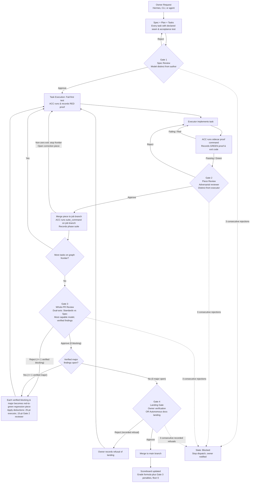

# Merge Gate Process (v0.5.0)

**Status**: Planned for v0.5.0; not implemented in v0.4.4
**Spec**: [specs/005-merge-gate/spec.md](../../specs/005-merge-gate/spec.md)
**Portuguese version**: [merge-gate.pt-BR.md](./merge-gate.pt-BR.md)

This document describes the test-driven merge gate architecture ("Portão de merge orientado a testes") that will ship in ACC v0.5.0. It is explicitly **not implemented** in the current v0.4.4 baseline.

## Flowchart



## The Four Gates

| Gate | Who Decides | What Must Exist |
|---|---|---|
| **1 · Spec** | Model different from the author | Every task has an acceptance criterion written as a test; each user story maps to a declared high-level test seam in `## Testing decisions`; every task names one of those seams as the place its first failing test runs; `tasks.md` defines a valid, cycle-free DAG using machine-readable `Blocked by:` syntax. |
| **2 · Piece** | Adversarial reviewer, never the executor model | Test "red" (failing) run recorded by ACC before implementation; test "green" (passing) run recorded by ACC after implementation, both executed directly by ACC (not claimed by any agent); if the sidecar expect key is non-empty, green requires that substring in the output in addition to exit 0. Gate 2 keeps the quota-family exclusion: the reviewer family must not be the family of that piece's executor. |
| **3 · PR** | Team of reviewers in parallel + finding verification, most capable model configured per project, subject to majority-executor exclusion | Full suite green on the job branch; PR reviewed against the request using two independent axes: **Standards** (repo documented standards take precedence; twelve named Fowler code smells reported as heuristic judgment calls only) and **Spec** (literal file paths to `spec.md` and `tasks.md` only, no coordinator summary). Findings are verified against diff hunks of the frozen merge-base...HEAD diff; a finding with no hunk is dropped. Each kept finding keeps its axis label (Standards or Spec), sorted by severity (`blocking`, `major`, `minor`, `heuristic`), and mapped to specific accepted pieces. Gate 3 rejects only when at least one verified finding is blocking; otherwise Gate 3 approves (major, minor, and heuristic findings do not reject Gate 3). An approval with zero blocking findings does not reach Gate 4 while any verified major finding is still open: each verified blocking finding and each verified major finding becomes its own red-to-green regression piece before landing. |
| **4 · Owner** | The owner | Summary of intent, risks, and what was not verified. Docs-only PRs without sensitive paths may merge without the owner if Gate 3 approved with zero blocking and zero major findings, the door is two-way, and `[merge_gate] owner_merge_only` is set to `false`. |

## Extended Design Decisions (A–D)

These decisions were added by the owner on 2026-10-28 and are adapted from [mattpocock/skills](https://github.com/mattpocock/skills) (MIT License, Copyright (c) 2026 Matt Pocock). They are folded into the same spec as part of the merge gate, not a separate feature.

### A. PR Body Template (Gate 3/4 Input)

ACC writes the job PR body with three sections:

1. **Summary**: The smallest view that shows the change — pseudocode, call tree, file tree, diff sketch, or mermaid diagram.
2. **Evidence**: Before/after for each accepted piece = the recorded failing test run and the recorded passing run from ACC's own test records (never from an agent's text).
3. **Merge Danger**:
   - **Door**: One-way (hard to undo: data migration, record format changes, public CLI/MCP contract alterations, deleting user data, release) or Two-way (easy to revert). The door class is a judgment the Gate 3 reviewer records; the listed one-way categories and unknown are one-way, and a pull request with no recorded class is unknown.
   - **Blast Radius**: One word plus the affected modules/paths (e.g., `isolated`, `module`, `subsystem`, `repository`, `ecosystem`).

**Copyable PR Body Template:**

```markdown
## Summary

<!-- Smallest concise view: pseudocode, call tree, file tree, diff sketch, or mermaid diagram -->

## Evidence

<!-- For each accepted piece: before (failing test run) and after (passing test run) from ACC records -->

### Piece T001
- **Before (RED)**: Exit code X, command: `...`, timestamp: `...`
- **After (GREEN)**: Exit code Y, command: `...`, timestamp: `...`

### Piece T002
- **Before (RED)**: ...
- **After (GREEN)**: ...

## Merge Danger

- **Door**: one-way / two-way
- **Blast Radius**: <one word> — <affected modules/paths>
```

### B. Two-Axis Review at Gate 3

Two independent reviewer runs over the same diff (merge-base three-dot diff `git diff <base>...HEAD`):

- **STANDARDS Axis**: Checks compliance with the repo's documented standards (`AGENTS.md`, `CONTRIBUTING.md`, coding standards). The twelve named Fowler code smells (*Refactoring*, ch. 3) are evaluated as a closed heuristic list (chapter 3 has more smells than those twelve) and reported as "possible X" — never as hard violations. The repo's own documented standard always wins.
- **SPEC Axis**: Checks whether the diff implements the job's `spec.md` and `tasks.md` (literal file paths only, no coordinator summary), identifying missing requirements, unrequested scope creep, and implementation errors.

Findings are reported side by side, each mapped to a piece. Each finding is verified against a hunk of the frozen merge-base...HEAD diff; a finding with no hunk is dropped.

### C. Tasks as a Graph

`tasks.md` declares explicit blocking edges per task in machine-readable form:

```markdown
- [ ] T001 [P?] [US1?] Description (Blocked by: none)
- [ ] T002 [P?] [US1?] Description (Blocked by: T001)
- [ ] T003 [P?] [US2?] Description (Blocked by: T001, T002)
```

The coordinator dispatches the **frontier** (all unblocked tasks within the parallelism cap `max_running_executors`, default 3) and recomputes it after each accept. Tasks are tracer-bullet vertical slices (each verifiable on its own, through every layer it needs), sized for one executor context. Prefactoring tasks specify `Blocked by: none`; later slices that need them list those task IDs in `Blocked by:`. A wide mechanical refactor is sequenced as expand → migrate in batches → contract instead of one slice.

### D. Test Seams in the Spec

`spec.md` gets two new sections:

- **Testing decisions**: Defines the seams where behavior is tested — prefer existing seams, the highest one possible, as few as possible. A good test exercises external behavior only through high-level public interfaces. Cite prior-art tests in the repo.
- **Out of scope**: Explicitly deferred capabilities.

Gate 1 checks that every user story maps to a declared seam in `## Testing decisions` and that each task's first failing test sits at a declared seam.

## Gate Table

| Gate | Who Decides | What Must Exist |
|---|---|---|
| 1 · Spec | Model different from the author | Every task has acceptance criterion as test; stories map to seams; tasks name seams; valid DAG with `Blocked by:` |
| 2 · Piece | Adversarial reviewer, never the executor | RED proof recorded before, GREEN proof recorded after, both run by ACC; reviewer family != executor family |
| 3 · PR | Most capable model per project, parallel reviewers | Suite green on job branch; dual-axis review (Standards + Spec) over merge-base three-dot diff; findings verified against hunks, mapped to pieces; blocking findings reject |
| 4 · Owner | The owner | Summary, evidence, merge danger (Door + Blast Radius); docs-only PRs without sensitive paths may land autonomously if `owner_merge_only = false`, two-way door, zero blocking/major findings |

## Scoring and Penalties

- Each attributed **blocking** or **major** defect at Gate 3 deducts **25 points** from that piece's executor and **15 points** from the approving Gate 2 reviewer.
- Caps are **separate**: executor Gate 3 deductions stop at 40 points per piece, and reviewer Gate 3 deductions stop at 40 points per piece. Any finding past the cap is still listed with deduction 0 and the reason "cap".
- These deductions apply **after** `grade()`'s existing correction deduction (15 points per correction), not instead of it, with a **floor of 0** after both.
- **Exact attribution is required**: the record must name the exact executor ID (including provider/route, e.g., `claude-ghost` via GhostCLI vs GhostNote, or the OpenCode route) and the reviewer that approved the piece, plus which finding maps to which piece. **No attribution, no penalty.**
- The scoreboard line displays the finding and the piece.

## Project Settings

Project preferences are configured in `docs/crew-chief/preferences.toml`:

```toml
[review]
capability_order = [
  "opencode:omni/cursor/grok-4.7-xhigh",
  "opencode:omni/cursor/grok-4.7-high",
  "claude-ghost:claude-opus-5-5",
  "claude-ghost:claude-sonnet-5",
  "opencode:omni/agy/gemini-3.8-flash-tiered"
]

[merge_gate]
suite_command = "pytest"
owner_merge_only = true
landing_sensitive_paths = [
  "AGENTS.md",
  "CLAUDE.md",
  ".github/**",
  "pyproject.toml",
  "docs/crew-chief/**",
  "skill/crew-chief/SKILL.md"
]
```

The keys `capability_order`, `suite_command`, `owner_merge_only`, and `landing_sensitive_paths` are project preferences. The parallelism cap `max_running_executors` stays in user preferences only.

## Majority-Executor Exclusion

When selecting the Gate 3 reviewer, ACC excludes the model that executed the **majority** of accepted pieces (counting by model, not by full executor route or quota family) whenever an alternative model exists within the project's configured capability list. Another route of the same model is the same model, not an alternative. If no active route remains after exclusion, Gate 3 does not run: the job state transitions to `blocked` and the owner is notified (no fallback).

## Three Rejections Stop

Three consecutive rejections at the same gate halt the job:

- **Gate 1**: Three consecutive spec rejections → blocked
- **Gate 2**: Three consecutive piece rejections → blocked
- **Gate 3**: Three consecutive PR rejections → blocked
- **Gate 4**: Three consecutive recorded refusals of landing → blocked

The counter resets to 0 on approval (or owner approval of landing at Gate 4).

## Docs-Only Exclusions

Documentation-only PRs may merge without the owner if ALL conditions are met:

1. `[merge_gate] owner_merge_only` is set to `false`.
2. Every changed path is a markdown file, and none of them is under `docs/crew-chief/` or is `skill/crew-chief/SKILL.md`.
3. No modified path matches any pattern in `[merge_gate] landing_sensitive_paths`.
4. Gate 3 approved with zero blocking and zero major findings.
5. The door is evaluated as **two-way**.

The default `owner_merge_only = true` keeps this repository owner-only without parsing `AGENTS.md` prose as a runtime switch. `AGENTS.md` remains the governing human rule.

## Out of Scope (Planned After v0.5.0)

The following are explicitly deferred out of v0.5.0:

1. **Job-end retro**: Automated post-job retrospective analysis converting repeated review findings into project-specific linter rules.
2. **Hermes triage**: Full integration of Hermes intake triage states (`triage:unconfirmed`, `triage:needs_repro`, `triage:ready_for_agent`) into ACC issue creation.
3. **Knowledge base**: Persistent, project-wide database cataloging previously rejected designs and deferred feature requests.

## Credits

Methods adapted from [mattpocock/skills](https://github.com/mattpocock/skills) (MIT License, Copyright (c) 2026 Matt Pocock):

- `pr`: Standardized PR body structure
- `code-review`: Two-axis review isolating Standards and Spec
- `to-tickets` / `implement-spec`: Machine-readable task graphs with explicit blocking edges
- `to-spec`: Specification structuring with declared test seams

No copied implementation; only methodology adaptations.

## Related Documents

- **Spec**: [specs/005-merge-gate/spec.md](../../specs/005-merge-gate/spec.md)
- **Portuguese version**: [merge-gate.pt-BR.md](./merge-gate.pt-BR.md)
- **Owner brief**: See owner brief and proposal in the normative spec ([specs/005-merge-gate/spec.md](../../specs/005-merge-gate/spec.md)).
- **Proposal**: See owner brief and proposal in the normative spec ([specs/005-merge-gate/spec.md](../../specs/005-merge-gate/spec.md)).
