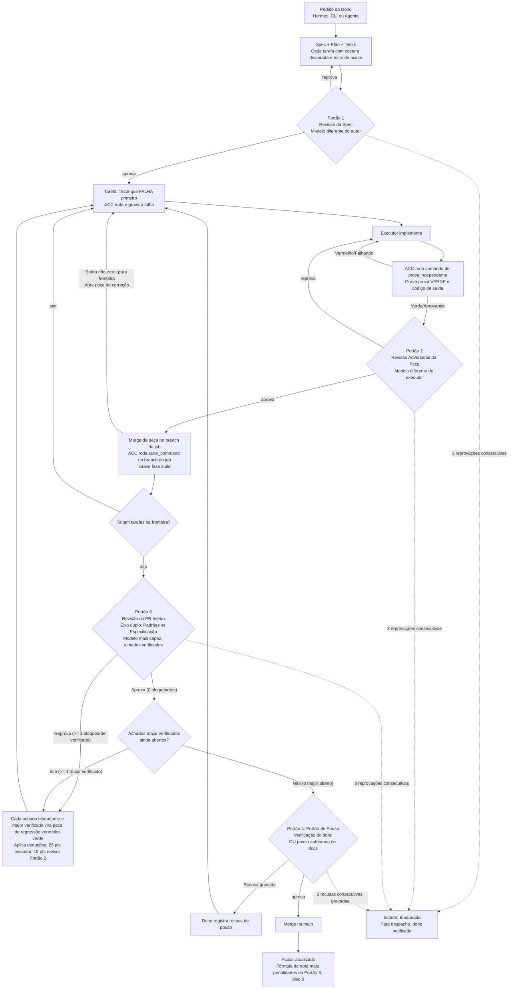

# Portão de Merge Orientado a Testes (v0.5.0)

Documentação em português brasileiro do portão de merge orientado a testes do Agent Crew Chief (ACC). Esta é uma especificação futura para v0.5.0, **não implementada** na versão atual v0.4.4.

Para a versão em inglês, veja [merge-gate.md](merge-gate.md). A especificação normativa está em [../../specs/005-merge-gate/spec.md](../../specs/005-merge-gate/spec.md).

## Visão Geral

O portão de merge garante que nenhuma afirmação de agente conte como prova. A execução de testes é registrada diretamente pelo runtime do ACC antes e depois de cada mudança, a revisão do PR inteiro avalia padrões e especificações independentemente usando o modelo revisor mais capaz disponível, a atribuição de defeitos impacta diretamente as notas do placar, e os pull requests declaram claramente seu raio de explosão e reversibilidade.

## Fluxo do Processo



## Os Quatro Portões

| Portão | Quem Decide | O Que Precisa Existir |
|---|---|---|
| 1 · Spec | Modelo diferente do autor | Cada tarefa tem critério de aceite escrito como teste; `tasks.md` define grafo DAG válido com sintaxe `Blocked by:`; cada história mapeia para costura de teste declarada em `## Testing decisions` |
| 2 · Peça | Revisor adversarial, nunca o modelo que executou | Teste vermelho gravado antes, verde gravado depois, ambos rodados pelo ACC; família do revisor ≠ família do executor daquela peça |
| 3 · PR | Equipe de revisores em paralelo + verificação dos achados, modelo mais capaz configurável por projeto | Suíte completa verde no branch do job; PR revisado contra o pedido nos eixos Padrões e Especificação; achados verificados contra hunk do diff freeze merge-base...HEAD |
| 4 · Dono | O dono (padrão `owner_merge_only = true`) | Resumo de intenção, evidências e Merge Danger (Door e Blast Radius). PR só de docs sem caminho sensível pode pousar autonomamente se `owner_merge_only = false`, porta bidirecional, Gate 3 aprovado com zero bloqueantes e zero major |

### Regras de Seleção do Revisor do Portão 3

O modelo revisor do Portão 3 é selecionado da hierarquia de capacidade configurável por projeto em `docs/crew-chief/preferences.toml` sob `[review] capability_order`. Padrão: `grok-4.7-xhigh` → `grok-4.7-high` → `claude-opus-5-5` → `claude-sonnet-5` → `gemini-3.8-flash-tiered`. O modelo que executou a maioria das peças aceitas é excluído quando existe alternativa. Se nenhuma rota ativa permanecer, o Portão 3 não executa: o job fica bloqueado e o dono é notificado (sem fallback).

## Corpo do Pull Request (Template)

Adaptado da habilidade `pr` de mattpocock/skills. O ACC escreve o corpo do PR do job com três seções obrigatórias:

### ## Summary

A menor visão concisa que esclarece a mudança. Use pseudocódigo, árvore de chamadas, árvore de arquivos, esboço de diff ou diagrama mermaid.

### ## Evidence

Para cada peça aceita, liste o registro de execução de teste com falha (antes) e com sucesso (depois), citando códigos de saída, comandos e timestamps dos registros do ACC. Nunca use afirmações verbais de agentes.

Exemplo:

```
Peça T001:
- ANTES (vermelho): exit 1, comando `pytest tests/test_feature.py::test_new_behavior`, 14:32:10 UTC
- DEPOIS (verde): exit 0, mesmo comando, substring esperada encontrada, 14:45:22 UTC
```

### ## Merge Danger

Declare o risco de merge em duas dimensões:

**Door:** `one-way` (difícil de desfazer) ou `two-way` (fácil de reverter).

Portas one-way incluem: deletar dados de usuário, migração de dados, mudanças de formato de registro, contrato público de CLI/MCP, release. Uma porta desconhecida é tratada como one-way. Qualquer porta one-way sempre requer merge manual do dono e não pode pousar autonomamente.

**Blast Radius:** Uma palavra (`isolated`, `module`, `subsystem`, `repository`, `ecosystem`) seguida pelos caminhos afetados.

Exemplo:

```
Door: two-way
Blast Radius: module — skill/crew-chief/scripts/crew_chief/sdd_gate.py, tests/test_sdd_gate.py
```

## Revisão de Dois Eixos no Portão 3

Adaptado da habilidade `code-review` de mattpocock/skills. Duas execuções de revisão independentes sobre o mesmo diff (diff de três pontos do merge-base: `git diff <base>...HEAD`):

### Eixo Padrões (Standards)

Verifica conformidade com os padrões documentados do repositório (`AGENTS.md`, `CONTRIBUTING.md`, padrões de codificação), que têm precedência absoluta. Os doze nomes de code smells de Fowler (*Refactoring*, cap. 3) são avaliados como lista heurística fechada (o capítulo 3 tem mais smells além desses doze) como julgamentos heurísticos ("possível X"), suprimidos sempre que os padrões do repositório permitem a construção, e nunca reportados como violações rígidas.

### Eixo Especificação (Spec)

Recebe o diff mais os caminhos literais para `spec.md` e `tasks.md` apenas, sem receber nenhum resumo ou paráfrase do coordenador. Reporta requisitos faltantes, escopo não solicitado (scope creep) e erros de implementação, citando linhas da spec para cada achado.

### Verificação de Achados

Um achado é verificado apenas quando cita um hunk do diff freeze merge-base...HEAD. Um achado sem hunk é descartado: não reprova o Portão 3, não altera a nota e não abre peça de regressão. Todos os tamanhos de PR (pequeno <100 linhas, médio 100-500, grande >500) aplicam a mesma verificação de hunk a cada achado. Cada achado mantido mantém seu rótulo de eixo (Padrões ou Especificação) para que o relatório possa mostrar os dois eixos lado a lado; a deduplicação por severidade acontece após o rótulo ser mantido.

Os achados são ordenados por severidade (`blocking`, `major`, `minor`, `heuristic`) e mapeados para IDs de peças aceitas específicas. O Portão 3 reprova apenas quando há pelo menos um achado bloqueante verificado; caso contrário aprova (achados major, minor e heurísticos não reprovam o Portão 3). Uma aprovação com zero achados bloqueantes não chega ao Portão 4 enquanto houver qualquer achado major verificado ainda aberto: cada achado bloqueante verificado e cada achado major verificado se torna sua própria peça de regressão vermelho-verde antes do pouso.

## Grafo de Tarefas com Dependências Explícitas

Adaptado das habilidades `to-tickets`/`implement-spec` de mattpocock/skills. As tarefas em `tasks.md` declaram dependências de bloqueio explícitas usando a sintaxe:

```markdown
- [ ] T001 [P?] [US1?] Descrição da tarefa (Blocked by: none)
- [ ] T002 [P?] [US1?] Outra tarefa (Blocked by: T001)
- [ ] T003 [P?] [US2?] Tarefa paralela (Blocked by: none)
- [ ] T004 [P?] [US2?] Depende de duas anteriores (Blocked by: T001, T003)
```

O parser valida que todos os IDs de tarefa correspondem a `T\d{3,}`, todos os IDs de bloqueador referenciados existem no arquivo, nenhuma tarefa bloqueia a si mesma, não há IDs duplicados e o grafo de dependências não contém ciclos.

O coordenador calcula a **fronteira de execução** (todas as tarefas incompletas com todos os bloqueadores marcados `[X]`) e despacha tarefas até o limite de paralelismo `max_running_executors` (padrão 3; preferências do usuário apenas, recusado por `docs/crew-chief/preferences.toml`), recalculando a fronteira a cada aceite de peça.

Tarefas representam fatias verticais tracer-bullet que cortam todas as camadas necessárias. Tarefas de prefatoração especificam `Blocked by: none`, e cada fatia posterior que precisa delas lista esses IDs em `Blocked by:`, para que a fronteira não possa começar a fatia primeiro. Refatores mecânicos amplos que abrangem muitos arquivos são estruturados como fases expandir-migratar-contrair.

## Costuras de Teste na Especificação

Adaptado da habilidade `to-spec` de mattpocock/skills. Toda especificação gerada sob ACC deve incluir as seções `## Testing decisions` e `## Out of scope`.

A seção `## Testing decisions` define costuras comportamentais observáveis de alto nível e cita arquivos de teste existentes no repositório como arte anterior. O Portão 1 rejeita qualquer especificação a menos que **cada história de usuário mapeie para uma costura declarada** em `## Testing decisions` E **cada tarefa nomeie uma dessas costuras** como o lugar onde seu primeiro teste com falha será executado.

### Definição de um Bom Teste

- Um bom teste exercita comportamento externo observável através de interfaces públicas de alto nível (invocações de CLI, requisições de protocolo MCP, estado de sistema de arquivos git, registros JSON persistentes).
- Testes nunca devem acoplar a funções auxiliares internas, variáveis privadas de módulo ou sequências específicas de chamadas de rotinas não exportadas.
- Testes devem ser determinísticos, isolados de acesso à rede, executáveis em sistemas de arquivos temporários locais e capazes de executar em menos de 10 segundos (esta orientação de 10 segundos não se aplica a `suite_command`).
- Para entregáveis de documentação e processo, usa-se verificação comportamental honesta (linting de markdown, validação de cabeçalhos, verificação de links, validação de schema) em vez de execuções de teste de código mock fabricado.

## Penalidades Determinísticas e Atribuição Exata

Cada achado bloqueante ou major do Portão 3 com atribuição exata deduz **25 pontos do executor** daquela peça e **15 pontos do revisor do Portão 2** que aprovou a peça. Os caps são separados: deduções do executor do Portão 3 param em 40 pontos por peça, e deduções do revisor do Portão 3 param em 40 pontos por peça. Qualquer achado além do cap ainda é listado com dedução 0 e a razão "cap". Essas deduções se aplicam **após** a dedução de correção existente de `grade()` (15 pontos por correção), não no lugar dela, com **piso 0 após ambas**. A linha do placar mostra o achado e a peça. **Sem atribuição exata, nenhuma dedução é aplicada.**

Atribuição exata significa: o registro deve nomear o ID exato do executor (incluindo provedor/rota, por exemplo `claude-ghost via ghostnote` vs `ghostcli`, ou a rota OpenCode) e o revisor que aprovou a peça, além de qual achado mapeia para qual peça.

As penalidades são aplicadas tanto no caminho de aprovação quanto no caminho de rejeição.

## Circuit Breakers de Reprovação Consecutiva

Três reprovações consecutivas no mesmo portão param o job e chamam o dono. Isso se aplica aos Portões 1, 2, 3 e 4 (para o Portão 4, três recusas gravadas consecutivas de pouso). O contador reseta para 0 upon aprovação (ou aprovação do dono de pouso no Portão 4).

## Pouso Autônomo e Caminhos Sensíveis

Controle por `[merge_gate] owner_merge_only` (booleano, padrão `true`). Quando `true`, o pouso autônomo está desligado e todos os PRs exigem merge do dono. `AGENTS.md` permanece como regra humana governante e o padrão `true` mantém este repositório como owner-only sem analisar prosa de `AGENTS.md` como switch de runtime.

Quando `owner_merge_only` é definido como `false`, PRs somente de documentação de baixo risco podem pousar autonomamente na main se TODAS as condições forem atendidas:

1. Todo caminho alterado é um arquivo markdown
2. Nenhum deles está sob `docs/crew-chief/` ou é `skill/crew-chief/SKILL.md`
3. Nenhum caminho modificado corresponde a qualquer padrão em `[merge_gate] landing_sensitive_paths` (padrão: `["AGENTS.md", "CLAUDE.md", ".github/**", "pyproject.toml", "docs/crew-chief/**", "skill/crew-chief/SKILL.md"]`)
4. Portão 3 aprovado com zero achados bloqueantes e zero major
5. Avaliado como porta bidirecional (two-way door)

Qualquer porta unidirecional (incluindo deletar dados de usuário, migração de dados, mudanças de formato de registro, alterações de contrato público de CLI/MCP, release ou desconhecida) sempre vai para o dono.

## Fora do Escopo (Planejado após v0.5.0)

As seguintes capacidades são explicitamente adiadas para versões futuras:

1. **Retrospectiva Automática no Fim do Job**: Análise retrospectiva pós-job automatizada que analisa comentários agregados de revisão e converte mecanicamente achados repetidos de revisão em regras de linter específicas do projeto ou verificações automáticas de pre-commit.
2. **Máquina de Estados de Triagem de Issues Hermes**: Integração completa dos rótulos de triagem de intake Hermes (`triage:unconfirmed`, `triage:needs_repro`, `triage:ready_for_agent`) nos fluxos de criação de issues e autorização de jobs do ACC.
3. **Base de Conhecimento Fora do Escopo**: Um banco de dados persistente ou wiki catalogando designs previamente rejeitados, ideias fora do escopo e solicitações de recursos adiadas entre jobs.
4. **Overrides Interativos de Portão na Pit Wall**: Controles de UI baseados em web ou botões interativos no dashboard Pit Wall para passar ou overriding manualmente portões; Pit Wall permanece estritamente read-only conforme estabelecido na v0.4.3.
5. **Cliente GitHub API Nativo**: Implementação de cliente REST/GraphQL nativo substituindo a CLI `gh`; ACC preserva `gh` como a única interface de entrega externa.

## Créditos

Metodologias adaptadas de [mattpocock/skills](https://github.com/mattpocock/skills), MIT License, Copyright (c) 2026 Matt Pocock:
- `pr`: Estrutura padronizada de corpo de PR
- `code-review`: Revisão de dois eixos isolando Padrões e Especificação
- `to-tickets` / `implement-spec`: Grafos de tarefas legíveis por máquina com fronteiras dinâmicas
- `to-spec`: Estruturação de especificação com costuras de teste declaradas

## Referências Cruzadas

- [Versão em inglês](merge-gate.md)
- [Especificação normativa](../../specs/005-merge-gate/spec.md)
- Proposta aprovada v0.4.5 (documento externo ao repositório)